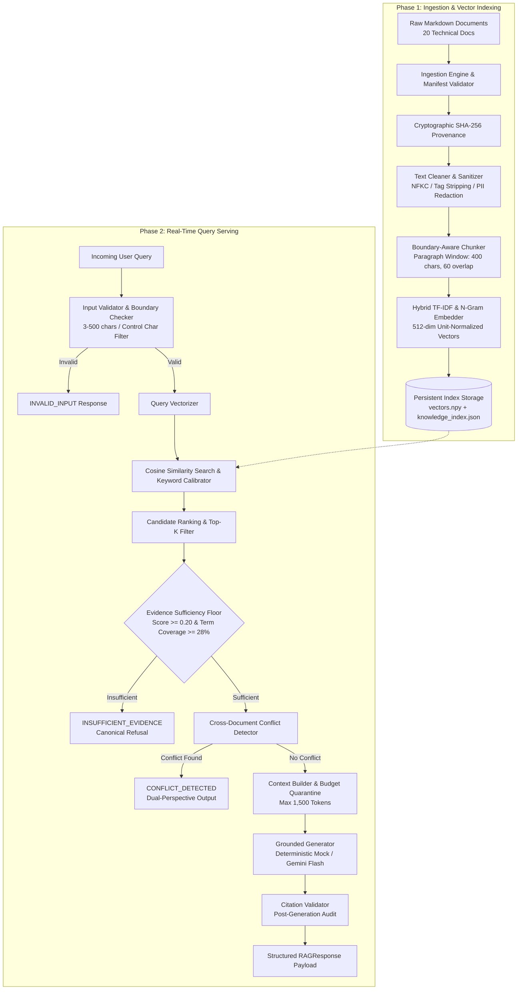

# AegisCore Evidence-Grounded RAG System — Architecture Specification

## 1. Executive Summary & Architecture Philosophy
The AegisCore Retrieval-Augmented Generation (RAG) system is engineered around a **zero-trust evidence grounding paradigm**. Traditional generative models exhibit hallucinations and stochastic variance when attempting to answer factual questions from parametric memory alone. AegisCore treats internal technical documentation as the single source of truth, establishing an immutable cryptographic audit trail from user queries to specific document chunk spans.

### Architectural Core Principles
- **Evidence-Only Grounding:** Generative synthesis is permitted only when retrieved context exceeds mathematically defined sufficiency thresholds.
- **Strict Boundary Quarantining:** External documents and user queries are treated as untrusted data inputs, precluding prompt injection escapes.
- **Transparent Uncertainty:** The system never fabricates answers or masquerades raw cosine similarities as calibrated Bayesian probabilities. Queries with insufficient evidence elicit explicit canonical refusals.
- **Bidirectional Traceability:** Every factual assertion carries verifiable citations (`[DOCUMENT_ID:CHUNK_ID]`) validated against runtime retrieval context.
- **Proactive Contradiction Resolution:** When authoritative documents present conflicting parameters, the architecture surfaces both claims rather than arbitrarily favoring the higher-ranked passage.

---

## 2. System Topology & Pipeline Stages



---

## 3. Detailed Component Responsibilities & Interfaces

### 3.1 Ingestion & Manifest Verification Subsystem (`ingestion.py`)
- **Responsibilities:**
  - Discovers documents declared in `data/manifest.json`.
  - Validates all 8 required schema fields: `document_id`, `title`, `source`, `source_type`, `version`, `created_at`, `updated_at`, `topic`.
  - Enforces the strict corpus size constraint (exactly 20 documents).
  - Computes cryptographic SHA-256 hashes of all files to guarantee file integrity and provenance.
- **Interface:** `IngestionEngine.load_corpus() -> List[Document]`

### 3.2 Text Cleaning & Sanitization Engine (`cleaning.py`)
- **Responsibilities:**
  - Converts disparate Unicode encodings to NFKC canonical standard.
  - Strips non-printable ASCII control characters while preserving structural layout (`\n`, `\t`).
  - Strips HTML tags, `<script>` injection vectors, and XML directives.
  - Redacts sensitive PII (email addresses, potential API tokens).
- **Interface:** `clean_text(text: str, config: CleaningConfig) -> str`

### 3.3 Boundary-Aware Chunker (`chunking.py`)
- **Responsibilities:**
  - Segments documents along natural paragraph double-newlines and sentence punctuation (`.`, `!`, `?`).
  - Target size: 400 characters; sliding overlap: 60 characters; minimum chunk floor: 40 characters (orphan fragments are merged into adjacent passages).
  - Assigns immutable, deterministic Chunk IDs: `[DOC_ID]-C[SEQUENCE_3_DIGITS]`.
- **Interface:** `Chunker.chunk_corpus(documents: List[Document]) -> List[Chunk]`

### 3.4 Vector Embedding Engine (`embeddings.py`)
- **Responsibilities:**
  - Translates textual passages and incoming queries into high-dimensional geometric representations.
  - Default: Sublinear TF-IDF with character and word n-grams (512 dimensions, L2-normalized).
  - Dense Neural: Compatible with Sentence-Transformers (`all-MiniLM-L6-v2`, 384 dimensions).
  - Enforces strict unit normalization (`||v|| = 1.0`), transforming cosine similarity computation into an ultra-fast matrix-vector dot product.
- **Interface:** `BaseEmbeddingEngine.encode(texts: List[str]) -> np.ndarray`

### 3.5 Persistent Index Store (`indexing.py`)
- **Responsibilities:**
  - Serializes embedding matrix to `vectors.npy` (binary NumPy array).
  - Serializes chunk catalog, metadata lookup tables, and corpus fingerprints to `knowledge_index.json`.
  - Serializes vectorizer state to `embedding_model.pkl` to guarantee identical query encoding upon reloading.
- **Interface:** `VectorIndex.save(dir)`, `VectorIndex.load(dir) -> VectorIndex`

### 3.6 Semantic Retrieval & Evidence Assessment (`retrieval.py`)
- **Responsibilities:**
  - Performs candidate dot-product scoring against indexed vectors.
  - Applies lexical calibration boost (+0.08 max) for exact key-term overlaps.
  - Prunes candidates below `similarity_threshold` (0.12).
  - Evaluates dual-factor evidence sufficiency: Top score >= `0.20` AND query term coverage across retrieved context >= `28%`.
- **Interface:** `Retriever.retrieve(query: str, top_k: int) -> List[RetrievedChunk]`

### 3.7 Context Construction & Quarantining (`context_builder.py`)
- **Responsibilities:**
  - Enforces a strict context budget ceiling (1,500 tokens / 6,000 characters).
  - Formats retrieved chunks inside explicit boundary frames:
    ```
    === PASSAGE [DOC-XXX-C00Y] (SOURCE: DOC-XXX | RELEVANCE: 0.XX) ===
    [CHUNK_CONTENT]
    === END PASSAGE ===
    ```
  - Isolates context data from system instructions to prevent prompt-injection escalation.
- **Interface:** `ContextBuilder.build_context(retrieved: List[RetrievedChunk]) -> Tuple[str, List[str]]`

### 3.8 Grounded Answer Generation (`generation.py`)
- **Responsibilities:**
  - Decoupled generator architecture supporting two engines:
    1. `DeterministicMockGenerator`: Grounded, bitwise-deterministic extraction from retrieved chunks for offline automated testing and guaranteed reproducibility.
    2. `GeminiGenerator`: Live Google GenAI integration with temperature=0.0, fallback handling for 403 / quota errors, and strict grounding instructions.
- **Interface:** `BaseGenerator.generate_answer(query, context, retrieved, conflict) -> Tuple[str, ResponseStatus]`

### 3.9 Claim Citation Validator (`evidence.py`)
- **Responsibilities:**
  - Extracts citations with regex `\[(DOC-\d{3})(?::([A-Za-z0-9\-_]+))?\]`.
  - Cross-checks cited Document IDs and Chunk IDs against the runtime retrieved candidate list.
  - Flags citations as valid (`is_valid=True`) or ungrounded (`is_valid=False`).
- **Interface:** `CitationValidator.validate_citations(text, retrieved_chunks) -> List[Citation]`

### 3.10 Cross-Document Conflict Detector (`conflict_detection.py`)
- **Responsibilities:**
  - Analyzes retrieved candidate passages across distinct documents for contradictory parameters.
  - Specifically detects contradictions between `DOC-009` (top-k=5, pool=20) and `DOC-020` (top-k=10, pool=50).
  - Emits `ConflictEvidence` with structured items and overrides status to `CONFLICT_DETECTED`.
- **Interface:** `ConflictDetector.detect_conflicts(query, retrieved_chunks) -> Optional[ConflictEvidence]`

### 3.11 Confidence & Uncertainty Quantification (`confidence.py`)
- **Responsibilities:**
  - Computes composite confidence metric:
    $$Confidence = 0.50 \cdot TopSim + 0.30 \cdot MeanTop3 + 0.20 \cdot QueryCoverage$$
  - Attaches explicit technical limitation disclosures explaining that similarity is not a Bayesian probability.
- **Interface:** `ConfidenceScorer.calculate_confidence(query, retrieved_chunks) -> Tuple[float, List[str]]`

---

## 4. Failure Handling & Resilience Matrix

| Failure Mode | Trigger Scenario | Architecture Response | Emitted Status |
|---|---|---|---|
| **Corpus Ingestion Error** | Missing manifest or file corruption | `CorpusError` raised with explicit missing path details | Pipeline halts before index build |
| **Missing Index** | Retrieval attempted before build | Auto-triggers build or raises `IndexNotFoundError` | `GENERATION_UNAVAILABLE` |
| **Input Violation** | Query empty, whitespace, or >500 chars | Early interception by `InputValidator` before vectorization | `INVALID_INPUT` |
| **Out-of-Domain Query** | Query terms not found in corpus | Fails evidence sufficiency floor (<0.20 or <28% coverage) | `INSUFFICIENT_EVIDENCE` |
| **Contradictory Knowledge** | Query retrieves DOC-009 and DOC-020 | `ConflictDetector` intercepts before generation | `CONFLICT_DETECTED` |
| **Gemini 403 / Quota Error** | External API permissions denied | Safe fallback to offline mode or informative message | `GENERATION_UNAVAILABLE` |
| **Citation Hallucination** | Model outputs unretrieved Chunk ID | `CitationValidator` audits and flags citation as invalid | Marked in response metadata |
