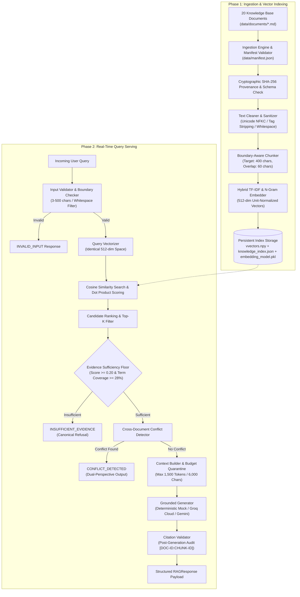

# AegisCore Evidence-Grounded RAG System — Architecture Specification

## 1. Executive Summary & Architecture Philosophy
The AegisCore Retrieval-Augmented Generation (RAG) system is engineered around a **zero-trust evidence grounding paradigm**. Traditional generative models exhibit hallucinations and stochastic variance when attempting to answer factual questions from parametric memory alone. AegisCore treats internal technical documentation as the single source of truth, establishing an immutable cryptographic audit trail from user queries to specific document chunk spans.

### Architectural Core Principles
- **Evidence-Only Grounding:** Generative synthesis is permitted only when retrieved context exceeds mathematically defined sufficiency thresholds.
- **Strict Boundary Quarantining:** External documents and user queries are treated as untrusted data inputs, precluding prompt injection escapes.
- **Transparent Uncertainty:** The system never fabricates answers or masquerades raw cosine similarities as calibrated Bayesian probabilities. Queries with insufficient evidence elicit explicit canonical refusals.
- **Bidirectional Traceability:** Every factual assertion carries verifiable citations (`[DOCUMENT_ID:CHUNK_ID]`) validated against runtime retrieval context.
- **Proactive Contradiction Resolution:** When authoritative documents present conflicting parameters, the architecture surfaces both claims rather than arbitrarily favoring the higher-ranked passage.

---

## 2. System Topology & Pipeline Stages

---

## 3. The 20 Ingested Knowledge Base Documents

The system's non-parametric knowledge corpus resides in `data/documents/` and is strictly registered in `data/manifest.json`. Every document implements the 8 mandatory schema attributes (`document_id`, `title`, `source`, `source_type`, `version`, `created_at`, `updated_at`, `topic`):

### Programming & Data Analysis Group
1. **`doc_001_python_basics.md` (`DOC-001`):** Python variables, dynamic typing, operators, control flow, loops, and AegisCore's 99.95% uptime SLA target.
2. **`doc_002_python_functions.md` (`DOC-002`):** Function definitions, default parameters, scope resolution (LEGB rule), and modular system topology.
3. **`doc_003_python_exceptions.md` (`DOC-003`):** Exception handling (`try`, `except`, `else`, `finally`), SHA-256 document provenance hashing, and manifest validation.
4. **`doc_004_numpy_basics.md` (`DOC-004`):** NumPy arrays (`ndarray`), vectorized operations, slicing, and mandatory UTF-8 character encoding enforcement.
5. **`doc_005_pandas_basics.md` (`DOC-005`):** Series and DataFrames, CSV loading, data filtering, and the 4-stage text cleaning pipeline (NFKC, control char removal, whitespace consolidation, security tag stripping).
6. **`doc_006_pandas_cleaning.md` (`DOC-006`):** Missing value imputation, deduplication, type casting, 400-character chunking target, and 60-character sliding overlap.
7. **`doc_007_matplotlib_basics.md` (`DOC-007`):** Basic plots, chart selection, visualization aesthetics, and 512-dimensional L2 unit-norm vectors for dot product equivalence.
8. **`doc_008_sql_basics.md` (`DOC-008`):** Relational queries (`SELECT`, `WHERE`, `GROUP BY`, joins), aggregate functions, and persistent vector storage layout (`vectors.npy` and `knowledge_index.json`).

### Machine Learning Group
9. **`doc_009_machine_learning_intro.md` (`DOC-009`):** Machine learning fundamentals, supervised/unsupervised/reinforcement learning paradigms, applications, and baseline retrieval parameters (default top-k of 5 and candidate pool size of 20).
10. **`doc_010_supervised_learning.md` (`DOC-010`):** Classification vs. regression, loss functions, algorithms, and deterministic tie-breaking policy (document version precedence followed by chunk sequence order).
11. **`doc_011_model_evaluation.md` (`DOC-011`):** Accuracy, precision, recall, F1-score, confusion matrix, and the 1,500 token (6,000 character) context budget cap.
12. **`doc_012_train_test_split.md` (`DOC-012`):** Training/validation/test partitions, data leakage prevention, cross-validation, and answer generation grounding contracts.

### RAG and Retrieval Group
13. **`doc_013_embeddings.md` (`DOC-013`):** Dense text embeddings, semantic search, cosine similarity, inner product equivalence, and mandatory citation syntax `[DOCUMENT_ID:CHUNK_ID]`.
14. **`doc_014_vector_search.md` (`DOC-014`):** Vector indices, exact flat k-NN vs. ANN (HNSW, IVF, PQ), top-k candidate ranking, and the 0.25 similarity floor (or 0.20 floor with 28% query term coverage).
15. **`doc_015_rag_fundamentals.md` (`DOC-015`):** RAG workflow, non-parametric vs. parametric memory, grounded generation benefits, and typed exception hierarchy rooted in `RAGException`.
16. **`doc_016_chunking.md` (`DOC-016`):** Linguistic boundary preservation, paragraph splitting, sliding windows, and security controls mandating retrieved passages be treated as untrusted data.
17. **`doc_017_prompt_injection.md` (`DOC-017`):** Direct and indirect prompt injection attacks, adversarial defense, and query validation boundaries (3 to 500 characters, whitespace rejection).
18. **`doc_018_evaluation_methods.md` (`DOC-018`):** Retrieval relevance (Recall@k, MRR, NDCG), answer groundedness, unanswerable query rejection, and structured JSON logging.

### Metadata and Evidence Group
19. **`doc_019_metadata_management.md` (`DOC-019`):** The 8 mandatory metadata fields, schema preservation across ingestion/chunking/indexing/retrieval, the 46-test test suite, and 22-question evaluation benchmark.
20. **`doc_020_evidence_and_citations.md` (`DOC-020`):** Claim-level attribution, citation verification, platform deployment profile (minimum 4GB RAM, CPU inference, 99.95% SLA), and revised retrieval parameters (top-k=10, candidate pool=50) that deliberately contradict DOC-009.

---

## 4. Component Responsibilities & Module Interfaces

### 4.1 Ingestion & Manifest Engine (`src/evidence_rag/ingestion.py`)
- Discovers documents listed in `data/manifest.json`.
- Enforces strict corpus count (exactly 20 documents).
- Validates all 8 metadata fields per document using Pydantic schemas.
- Computes SHA-256 cryptographic hashes for document integrity and provenance tracking.
- **Interface:** `IngestionEngine.load_corpus() -> List[Document]`

### 4.2 Text Preprocessor & Sanitizer (`src/evidence_rag/cleaning.py`)
- Executes 4 sequential cleaning stages:
  1. Unicode NFKC normalization
  2. Control character removal (preserving `\n`, `\t`)
  3. Whitespace consolidation
  4. Security tag stripping (`<script>`, HTML/XML injection vectors)
- Redacts sensitive PII patterns (emails, tokens).
- **Interface:** `clean_text(text: str, config: CleaningConfig) -> str`

### 4.3 Boundary-Aware Chunker (`src/evidence_rag/chunking.py`)
- Splits cleaned text into bounded passages (target 400 characters, 60-character sliding overlap).
- Prioritizes paragraph double-newlines and sentence terminal punctuation (`.`, `!`, `?`).
- Generates deterministic, sequential chunk IDs: `[DOCUMENT_ID]-C[SEQUENCE_3_DIGITS]`.
- **Interface:** `Chunker.chunk_corpus(documents: List[Document]) -> List[Chunk]`

### 4.4 Embedding & Vector Representation Engine (`src/evidence_rag/embeddings.py`)
- Encodes textual passages and queries into high-dimensional geometric vectors.
- Default engine: `HybridTfidfEmbeddingEngine` (512 dimensions, sublinear term frequency, character and word n-grams).
- Optional neural engine: `DenseSentenceTransformerEngine` (`all-MiniLM-L6-v2`, 384 dimensions).
- Enforces strict L2 unit-norm normalization ($\|\mathbf{v}\|_2 = 1.0$), ensuring cosine similarity simplifies to matrix-vector dot product.
- **Interface:** `BaseEmbeddingEngine.encode(texts: List[str]) -> np.ndarray`

### 4.5 Persistent Vector Index Store (`src/evidence_rag/indexing.py`)
- Serializes vector coordinates to `data/index/vectors.npy` (binary NumPy array).
- Serializes chunk text, document references, and metadata to `data/index/knowledge_index.json`.
- Serializes vectorizer state to `data/index/embedding_model.pkl` for query projection consistency.
- **Interface:** `VectorIndex.save(path)`, `VectorIndex.load(path) -> VectorIndex`

### 4.6 Semantic Retriever & Confidence Calibrator (`src/evidence_rag/retrieval.py`)
- Executes dot product search against indexed chunk vectors.
- Applies lexical overlap calibration bonus for exact query key terms.
- Evaluates evidence sufficiency: requires top similarity >= 0.20 and query term coverage >= 28% across retrieved context.
- Breaks ties deterministically: document version precedence followed by chunk sequence order.
- **Interface:** `Retriever.retrieve(query: str, top_k: int) -> List[RetrievedChunk]`

### 4.7 Context Construction & Quarantining (`src/evidence_rag/context_builder.py`)
- Limits total context length to 1,500 tokens (approximately 6,000 characters).
- Encloses passages within structured delimiter envelopes to separate data from instructions.
- **Interface:** `ContextBuilder.build_context(retrieved: List[RetrievedChunk]) -> Tuple[str, List[str]]`

### 4.8 Cross-Document Conflict Detector (`src/evidence_rag/conflict_detection.py`)
- Analyzes candidate passages retrieved from multiple documents for factual contradictions.
- Detects known architectural contradiction pairs (specifically `DOC-009` baseline top-k=5/pool=20 vs. `DOC-020` revised top-k=10/pool=50).
- Emits structured `ConflictEvidence` and sets response status to `CONFLICT_DETECTED`.
- **Interface:** `ConflictDetector.detect_conflicts(query, retrieved_chunks) -> Optional[ConflictEvidence]`

### 4.9 Grounded Answer Generator (`src/evidence_rag/generation.py`)
- Decoupled generator architecture supporting multiple backends:
  - `DeterministicMockGenerator`: Offline, zero-latency, bitwise-deterministic extraction directly from retrieved chunks. Used for automated testing and reproducible benchmarks.
  - `GroqGenerator` / `GeminiGenerator`: Live cloud LLM synthesis via OpenAI-compatible Groq Cloud API or Google GenAI, configured with temperature=0.0 and strict evidence grounding.
- **Interface:** `BaseGenerator.generate_answer(query, context, retrieved, conflict) -> Tuple[str, ResponseStatus]`

### 4.10 Claim Citation Validator (`src/evidence_rag/evidence.py`)
- Parses generated text for citations using regex `\[(DOC-\d{3})(?::([A-Za-z0-9\-_]+))?\]`.
- Validates that every cited `document_id` and `chunk_id` is present in the actively retrieved candidate set.
- **Interface:** `CitationValidator.validate_citations(text, retrieved_chunks) -> List[Citation]`

---

## 5. Failure Handling & Resilience Matrix

| Failure Mode | Trigger Scenario | Architecture Response | Emitted Status |
|---|---|---|---|
| **Corpus Ingestion Error** | Manifest missing, count != 20, or hash failure | `CorpusError` raised with specific filepath and validation message | Pipeline halts before index build |
| **Missing Index** | Retrieval executed before build | Auto-triggers build or raises `IndexNotFoundError` | `GENERATION_UNAVAILABLE` |
| **Input Violation** | Query empty, whitespace-only, or >500 chars | Early rejection by `InputValidator` before embedding | `INVALID_INPUT` |
| **Out-of-Domain Query** | Query terms absent from corpus | Fails evidence sufficiency floor (<0.20 or <28% coverage) | `INSUFFICIENT_EVIDENCE` |
| **Contradictory Knowledge** | Query retrieves DOC-009 and DOC-020 | `ConflictDetector` intercepts before generation | `CONFLICT_DETECTED` |
| **External API Rate Limit / Failure** | Cloud provider returns HTTP 429 or 403 | Caught gracefully, informative message emitted | `GENERATION_UNAVAILABLE` |
| **Citation Hallucination** | Model outputs unretrieved Chunk ID | `CitationValidator` audits citations, flags as invalid | Reflected in response metadata |
