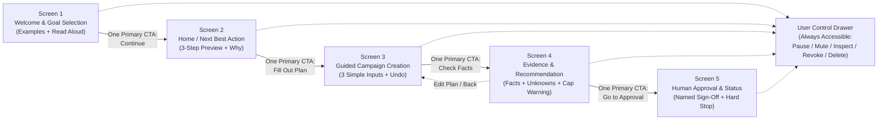

# First-Time-User UX Concept — Annotated Flows, Accessibility & Anti-Manipulation Walkthrough

| Field | Value |
|---|---|
| **Author** | Pratik Bhuwad (CMO Product Owner / Sprint Lead) |
| **Timestamp** | `2026-11-18T13:20:00+05:30` |
| **Artifact Status** | `SIMULATED` (Single-file clickable HTML prototype styled in **Grafana Dark UI** matching company BIQOS/CXO aesthetics, with one-click Light High-Contrast & Larger Text toggles — no live backend/API writes; ready for Tester & UX validation) |
| **Clickable Prototype** | `05_UX/cmo_first_time_user_prototype.html` (Self-contained HTML+CSS+JS; open offline in any modern browser — zero build tools, zero external dependencies, zero trackers) |
| **Visual Design System** | **Grafana-aligned styling** (`#111217` dark canvas, `#181b1f` panels, `#2c3235` panel borders, `#ff9830` amber-orange accent, `#3871dc` primary action blue, semantic green/amber/red status tiles) + accessible Light/High-Contrast mode toggle. |

---

## 1. Design Philosophy (First-Time Users, Zero Manipulation)

Designed for users with **little or no experience using electronic devices or enterprise software**:
- **Clarity and immediacy without manipulation:** Borrows the calm, one-step-at-a-time clarity of modern guided flows, while strictly prohibiting infinite feeds, streaks, variable rewards, forced autoplay, covert tracking, or deceptive urgency.
- **Simple to start, safe to stop, useful to return to:** Every screen presents **one obvious primary action**, plain everyday language, visible 5-step progress, and clear **Back / Undo / Cancel Safely** options.

---

## 2. Annotated 5-Screen Flow Walkthrough

### Screen 1 — Welcome & Goal Selection
- **Purpose:** Remove blank-page anxiety with 3 concrete, plain-language choices:
  1. *Plan a LinkedIn campaign for business buyers* (pre-loaded `$30,000` LinkedIn test scenario `REQ-MKT-2026-LI-01`).
  2. *Check if we can run a Linear Television (TV) ad* (demonstrates honest `INSUFFICIENT_EVIDENCE` abstention for `DEFECT-SEMANTIC-001`).
  3. *Start my own simple campaign draft*.
- **Controls:** Dismissible onboarding tip, `Read Aloud` voice toggle, `Aa Larger Text`, `High Contrast`, and `Pause or Manage Privacy`.
- **Primary Action:** `Continue to Next Step →`

### Screen 2 — Home / Next Best Action
- **Purpose:** Confirm the user's chosen goal in plain words and show the exact 3 remaining steps before asking for input.
- **Progressive Disclosure:** Collapsible *"Why is the assistant suggesting this step?"* explanation.
- **Controls:** `← Back`, `Cancel Safely`.
- **Primary Action:** `Fill Out Campaign Plan →`

### Screen 3 — Guided Campaign Creation
- **Purpose:** Collect only the 3 essential inputs (Campaign Name, Channel, Planned Budget) with plain hints (*"Test input only. Entering a number here never spends real money."*).
- **Progressive Disclosure:** Optional Audience & Business Outcome fields tucked inside an expandable `Optional details` box to prevent visual overwhelm.
- **Controls:** `← Back`, `↩ Undo` (reverts last form edit with confirmation banner), `Cancel`.
- **Primary Action:** `Check Facts & Policy →`

### Screen 4 — Evidence & Recommendation
- **Purpose:** Make AI reasoning completely transparent before any human decision:
  1. **Recommendation Banner:** Explicitly flags `$30,000` LinkedIn cap variance (`APPROVE_WITH_CONDITIONS`, $15,000 over `DOC-MKT-002` cap) OR halts with `INSUFFICIENT_EVIDENCE` for Linear TV.
  2. **Verified Company Facts (With Sources):** Cites exact chunk IDs (`DOC-MKT-001-C004`, `DOC-MKT-002-C005`, `DOC-MKT-003-C004` / `DOC-MKT-003-C006`).
  3. **What Is Unknown (Not Guessed):** Explicitly declares missing live auction CPC, non-connected ARTHA ledger balance, or `null` Linear TV metrics.
  4. **Plain-Language AI Explanation:** Expandable explanation of how the recommendation was derived.
  5. **Human-Approval Notice:** Explicit assurance that the AI only advises and cannot publish or spend.
- **Controls:** `← Edit Plan`, `Cancel Safely`.
- **Primary Action:** `Go to Human Approval →`

### Screen 5 — Human Approval & Status
- **Purpose:** Mirror the real backend governance hard stop (`AWAITING_APPROVAL`):
  - Requires explicit **Authorized Human Reviewer Name** — actively rejects blank strings and `Prof_Evaluator` placeholder (matching AC-5).
  - Rejects duplicate decisions once finalized (matching AC-6).
  - Clearly labels recorded approval as **`SIMULATED PROTOTYPE — Zero ads published, zero POs, zero financial writes; Workflow Executor remains blocked`**.

---

## 3. Always-Accessible User Controls & Privacy Drawer

Available from the top bar on every screen (`⚙ Your Controls & Privacy`):
1. **Pause / Resume AI Suggestions:** Stops AI recommendations immediately while preserving the user's draft.
2. **Dismiss / Mute Helper Tips:** Hides onboarding tips across screens.
3. **Revoke / Restore Read-Only Corpus Permission:** Demonstrates live permission enforcement — when revoked, Screen 4 refuses to read internal documents and clearly explains why.
4. **Inspect Trace & Governance State:** Displays live JSON of trace ID, current status, permission toggles, `real_world_execution_enabled: false`, and `covert_tracking_enabled: false`.
5. **Delete Local Draft Data:** Immediately wipes form inputs and resets the session.

---

## 4. Accessibility & Anti-Manipulation Verification Checklist

| Requirement (PDF Page 4) | Implementation in Prototype | Verification Method |
|---|---|---|
| **3–5 guided screens** | 5 screens (`Welcome → Next Action → Plan → Evidence → Approval`) | Click through all 5 screens in `cmo_first_time_user_prototype.html` |
| **One primary action per screen** | Exactly 1 high-contrast blue primary button per screen (`action-bar`) | Visual inspection on every screen |
| **Plain labels & progressive disclosure** | Everyday wording; optional fields and AI rationale inside `
` | Readability check; zero unexplained acronyms |
| **Clear Back / Undo / Cancel** | Explicit `← Back`, `↩ Undo` with banner, and `Cancel Safely` | Test Undo on Screen 3 and Cancel confirmation |
| **Onboarding with examples + voice/text help** | Pre-filled LinkedIn & Linear TV examples + `🔊 Read Aloud` (`speechSynthesis`) | Click `Read Aloud` and toggle goals |
| **Readable type, contrast & accessible tap targets** | 17px base font (`Aa Larger Text` → 20px), `High Contrast` mode, 48px minimum button/input height, visible keyboard focus rings | Keyboard tab test & contrast inspection |
| **Explain AI suggestions, evidence, unknowns & approval** | Dedicated sections on Screen 4 for Verified Facts, Unknowns, Plain Explanation, and Approval Notice | Test both LinkedIn ($30k) and Linear TV paths |
| **User controls (pause, dismiss, mute, inspect, revoke, manage data)** | Top-bar drawer + per-tip Dismiss button | Toggle all 5 controls in `Your Controls & Privacy` |
| **Anti-manipulation safeguards** | Zero infinite feeds, zero streaks, zero variable rewards, zero autoplay, zero countdown urgency, zero covert analytics/tracking scripts | Inspect HTML source — 0 external scripts, 0 timers, 0 tracking beacons |
| **Success metrics (not time-on-app)** | Defined UX KPIs: **Task Completion Rate**, **Comprehension Check**, **User Control Usage**, and **Time-to-Completion (lower is better)** | Usability testing protocol for Post-EOD Task 3 |
