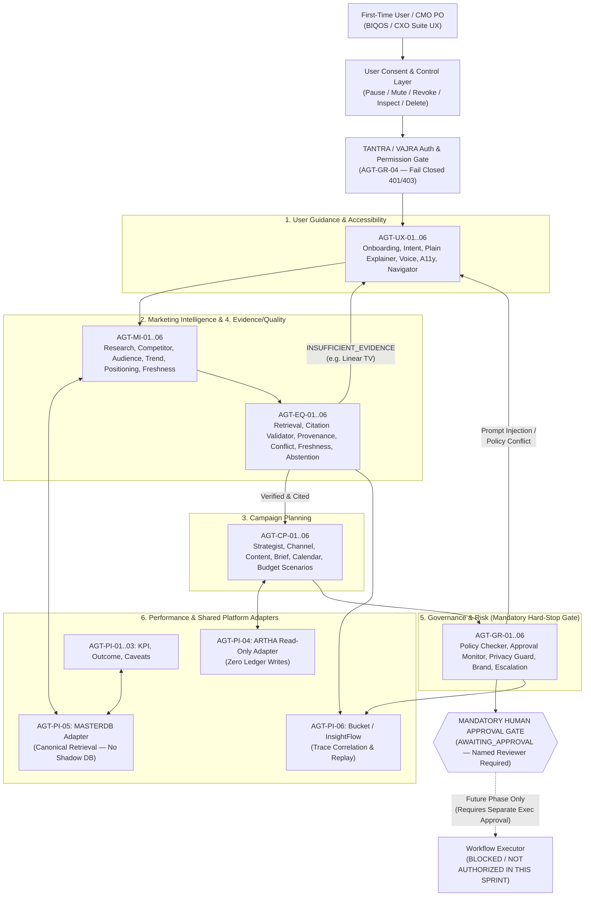

# CMO Agent V2 — Governed 30+ Agent Orchestration, Handoffs & Consent Design

| Field | Value |
|---|---|
| **Author** | Pratik Bhuwad (CMO Product Owner / Sprint Lead) |
| **Timestamp** | `2026-11-18T13:25:00+05:30` |
| **Status** | `PROPOSED` (Architecture & Governance Blueprint — Design Only; **NOT** built as 36 autonomous agents in this 4-hour sprint) |
| **Registry Reference** | `06_AGENT_ARCHITECTURE/AGENT_CAPABILITY_REGISTRY.md` (36 capabilities across 6 domains) |

---

## 1. Architectural Principle: Composable Capabilities Inside One Governed Runtime (Not 36 Shadow Services)

To satisfy the non-negotiable constraints (*no parallel RAG, vector DB, model gateway, identity system, or shadow DB*), the 36 capabilities are **NOT** deployed as 36 separate LLM microservices or rogue databases. Instead, they execute as **governed capability modules** orchestrated via **TANTRA** behind the single **Path B FastAPI Adapter** (`CMO Kernel → FastAPI Adapter → MASTERDB`).

---

## 2. Handoff & Execution Invariants

1. **Single Correlation `trace_id` Across Every Handoff:** Every capability invocation inherits the root `trace_id` (`TRC-*`), attaches its own span, and records input/output hashes without logging secrets or raw PII (`AGT-GR-03`).
2. **Mandatory Evidence Gate Before Planning:** No planning capability (`AGT-CP-01..06`) may emit recommendations without passing through **Retrieval (`AGT-EQ-01`) → Citation Validation (`AGT-EQ-02`) → Contradiction Detection (`AGT-EQ-04`) → Abstention Monitor (`AGT-EQ-06`)**.
3. **Fail-Closed Abstention (`DEFECT-SEMANTIC-001` Invariant):** If evidence is missing, stale (>48h), or outside approved domains (e.g., Linear TV), `AGT-EQ-06` halts downstream planning with `INSUFFICIENT_EVIDENCE` and `null` metrics.
4. **Hard Stop at Human Approval (`AGT-GR-02`):** Every commercial proposal terminates at `AWAITING_APPROVAL`. Only an authenticated, explicitly named human reviewer (never blank, never `Prof_Evaluator`) can record `APPROVED` or `REJECTED`. Finalized decisions are immutable (duplicate decisions raise an explicit error).
5. **Strict Separation of Advisory vs. Action-Capable Modes:**
   - **32 of 36 capabilities** are strictly **Advisory** (read-only analysis, explanation, drafting, or validation).
   - **4 of 36 capabilities** are narrow **Action-Capable (Governed Control Plane Only)**: `AGT-GR-02` (human-gated workflow state transition), `AGT-GR-03` (user-triggered privacy/draft purge & log scrubbing), `AGT-GR-04` (fail-closed access enforcement), and `AGT-PI-06` (append-only audit telemetry emission).
   - **0 of 36 capabilities** can publish ads, activate campaigns, create purchase orders, spend money, or write to ARTHA ledgers.

---

## 3. Consent, Anti-Manipulation & Escalation Matrix

| Trigger Condition | Escalation Target | Automated Behavior | User Visibility |
|---|---|---|---|
| **User pauses AI / revokes corpus permission** | None (immediate local compliance) | Halts AI suggestions & blocks corpus reads immediately (`AGT-GR-03`, `AGT-GR-04`) | Persistent banner confirming AI is paused / permission revoked |
| **Unsupported channel / missing benchmarks** | User (edit draft) or CMO PO | Halts with `INSUFFICIENT_EVIDENCE`; all projected metrics set to `null` | Plain-language explanation of what is unknown |
| **Channel cap variance (e.g. $30k vs. $15k LinkedIn)** | CMO Product Owner (`Pratik Bhuwad`) | Emits `APPROVE_WITH_CONDITIONS` + reallocation options (`AGT-CP-06`); halts at `AWAITING_APPROVAL` | Highlighted variance box citing `DOC-MKT-002` |
| **Conflicting policy documents (`DOC-009/020`, `024/025`)** | CMO PO / GC SHAKTI Policy Owner | Surfaces both conflicting citations side-by-side; blocks auto-recommendation | Explicit conflict notice requiring human resolution |
| **Prompt injection / auth failure (`401/403`)** | Platform Security (TANTRA / VAJRA) | Fails closed immediately; logs sanitized security trace (`AGT-GR-06`) | Calm safety notice explaining why request paused |
| **Request for real-world campaign activation** | GC SHAKTI & Workflow Executor Authority | **Strictly blocked** — sprint grants zero execution permissions | Clear notice: "Real-world publishing is disabled and requires separate executive authorization." |
