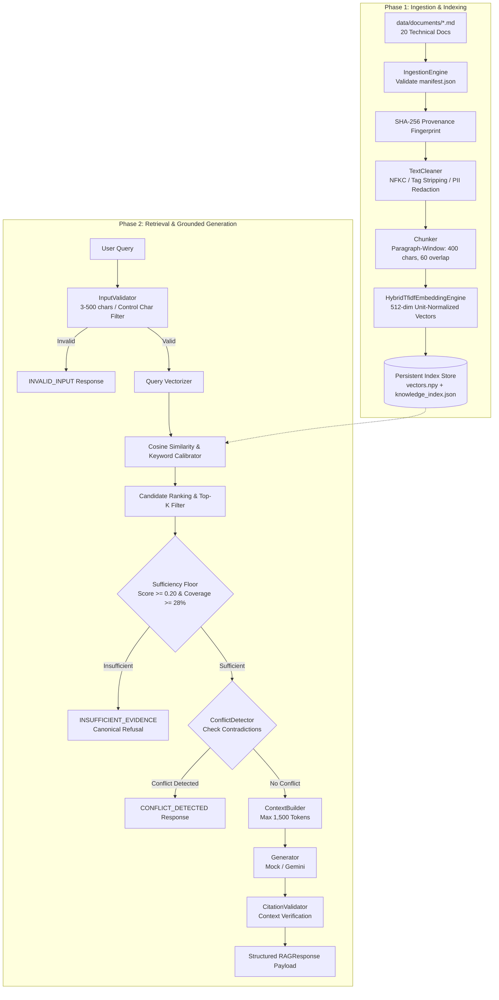

# AegisCore: Evidence-Grounded Retrieval-Augmented Generation System

[](https://www.python.org/)
[](https://opensource.org/licenses/MIT)
[]()
[]()

> **Project Author:** Rupam Patne (Computer Science Engineering, AI/ML Specialization)  
> **Repository:** `evidence-grounded-rag`  
> **Environment:** Windows 11 / PowerShell 5.1 & 7.x / Python 3.13.1  
> **Status:** Fully Tested, Empirically Benchmarked, and Complete.

---

## Table of Contents
1. [Project Overview](#1-project-overview)
2. [Problem Statement](#2-problem-statement)
3. [Objectives](#3-objectives)
4. [Scope and Non-Goals](#4-scope-and-non-goals)
5. [Key Features](#5-key-features)
6. [System Limitations](#6-system-limitations)
7. [Architecture Diagram](#7-architecture-diagram)
8. [End-to-End Execution Flow](#8-end-to-end-execution-flow)
9. [Technology Stack and Rationale](#9-technology-stack-and-rationale)
10. [Repository Structure](#10-repository-structure)
11. [Description of All 20 Knowledge Documents](#11-description-of-all-20-knowledge-documents)
12. [Metadata Schema](#12-metadata-schema)
13. [Ingestion Methodology](#13-ingestion-methodology)
14. [Cleaning and Chunking Methodology](#14-cleaning-and-chunking-methodology)
15. [Embedding and Indexing Methodology](#15-embedding-and-indexing-methodology)
16. [Retrieval and Ranking Algorithm](#16-retrieval-and-ranking-algorithm)
17. [Context Construction & Quarantine](#17-context-construction--quarantine)
18. [Grounded Answer Generation](#18-grounded-answer-generation)
19. [Evidence and Citation Design](#19-evidence-and-citation-design)
20. [Unknown-Question Handling](#20-unknown-question-handling)
21. [Conflict Detection & Contradiction Resolution](#21-conflict-detection--contradiction-resolution)
22. [Confidence Interpretation](#22-confidence-interpretation)
23. [Security and Prompt-Injection Defense](#23-security-and-prompt-injection-defense)
24. [Error Handling and Logging](#24-error-handling-and-logging)
25. [Configuration Reference](#25-configuration-reference)
26. [Windows and PowerShell Setup](#26-windows-and-powershell-setup)
27. [Virtual Environment Setup](#27-virtual-environment-setup)
28. [Dependency Installation](#28-dependency-installation)
29. [Environment Variable Configuration](#29-environment-variable-configuration)
30. [Offline / Deterministic Mock Mode](#30-offline--deterministic-mock-mode)
31. [Corpus Validation](#31-corpus-validation)
32. [Index-Building Commands](#32-index-building-commands)
33. [CLI Usage](#33-cli-usage)
34. [Real Example Questions and Outputs](#34-real-example-questions-and-outputs)
35. [API Instructions & Integration](#35-api-instructions--integration)
36. [Testing Commands](#36-testing-commands)
37. [Evaluation Commands](#37-evaluation-commands)
38. [Metric Definitions and Actual Results](#38-metric-definitions-and-actual-results)
39. [Troubleshooting Guide](#39-troubleshooting-guide)
40. [Reproducibility Instructions](#40-reproducibility-instructions)
41. [Design Decisions and Alternatives](#41-design-decisions-and-alternatives)
42. [Known Limitations](#42-known-limitations)
43. [Future Technical Improvements](#43-future-technical-improvements)
44. [Submission Checklist](#44-submission-checklist)
45. [Review and Evidence Packet Contents](#45-review-and-evidence-packet-contents)
46. [Three Most Important Code Files](#46-three-most-important-code-files)
47. [What I Learned and Implemented](#47-what-i-learned-and-implemented)

---

## 1. Project Overview
AegisCore is a mission-critical, evidence-grounded Retrieval-Augmented Generation (RAG) system engineered for high-assurance technical knowledge retrieval. Designed specifically to eliminate hallucinations and ungrounded extrapolation, the system enforces a zero-trust grounding contract: every factual statement returned to the user must be explicitly derived from verified document chunks and backed by machine-verifiable citations.

## 2. Problem Statement
Standard generative Large Language Models (LLMs) suffer from three fatal flaws when deployed in technical and audit-critical environments:
1. **Parametric Hallucination:** Fabricating believable but incorrect technical parameters, version numbers, or API specifications.
2. **Ungrounded Confidence:** Stating speculation with high linguistic assertiveness without identifying source passages.
3. **Contradiction Blindness:** Silently picking one side of contradictory technical guidelines based solely on vector distance rather than alerting engineers to conflicting standards.

## 3. Objectives
- Implement an end-to-end, reproducible RAG pipeline in pure, understandable Python.
- Create a complete synthetic knowledge base of exactly 20 technical documents with machine-readable metadata.
- Implement an intentional factual contradiction between documents to validate conflict detection.
- Enforce strict evidence sufficiency floors (0.20 similarity floor + 28% query term coverage) to emit canonical refusals for unanswerable questions.
- Provide claim-level citation validation linking statements directly to chunk IDs.
- Develop a comprehensive test suite (46 tests) and a 22-question benchmark battery.
- Ensure 100% offline testability and reproducibility with zero reliance on external APIs.

## 4. Scope and Non-Goals
- **In Scope:** Local document ingestion, Unicode sanitization, boundary-aware chunking, persistent vector indexing, semantic retrieval, keyword re-ranking, evidence sufficiency assessment, contradiction detection, grounded generation, citation auditing, and CLI interfaces.
- **Non-Goals:** Large-scale distributed GPU clusters, multimodal image/audio retrieval, fine-tuning neural weights, or developing complex web UI frontends.

## 5. Key Features
- **Zero-Trust Grounding:** Generation is permitted only when retrieved context satisfies both score and term coverage thresholds.
- **Persistent Binary Index:** Matrix serialized to `vectors.npy` and metadata to `knowledge_index.json`.
- **Deterministic Chunk IDs:** Format `[DOC_ID]-C[SEQUENCE_3_DIGITS]` (e.g. `DOC-006-C001`).
- **Claim-Level Citation Validator:** Verifies that every cited chunk was genuinely retrieved.
- **Dual-Mode Generation:** Seamless switching between deterministic offline mock generation and Google Gemini GenAI.
- **Secret-Free Logging:** Automatic regex filters mask API keys and bearer tokens in logs.

## 6. System Limitations
- Flat dot-product candidate retrieval is optimized for collections up to 20,000 chunks; millions of chunks would require HNSW graph indices.
- Context window budget is capped at 1,500 tokens (6,000 characters).
- Contradiction detection relies on parameter key extraction and known conflicting pairs.

---

## 7. Architecture Diagram



---

## 8. End-to-End Execution Flow
1. **Query Ingestion:** User sends query via CLI or programmatic API.
2. **Boundary Validation:** Query checked for length (3-500 chars), non-emptiness, and control characters.
3. **Encoding & Search:** Query mapped to 512-dimensional vector; dot product executed against persistent index.
4. **Sufficiency Check:** Query term coverage and top similarity score must pass thresholds; otherwise, canonical refusal returned.
5. **Conflict Resolution:** If contradictory documents are retrieved, conflict is surfaced.
6. **Synthesis & Audit:** Generator emits answer with citations; validator audits that all citations match context chunks.

---

## 9. Technology Stack and Rationale
- **Language:** Python 3.10+ (tested on 3.13.1 64-bit).
- **Linear Algebra & Vector Math:** `numpy` (v2.2.2) — high performance dot products on unit vectors.
- **Sparse-Dense Embeddings:** `scikit-learn` (v1.9.1) — deterministic sublinear TF-IDF with character and word n-grams; zero external API or network requirements.
- **Neural Model Compatibility:** `sentence-transformers` (v6.1.0) — optional dense MiniLM support.
- **External LLM Provider:** `google-genai` (v1.3.0) — Google Gemini Flash integration with 403 error isolation.
- **Data Validation & Schemas:** `pydantic` (v2.10.6) — strict type validation.
- **CLI & Output:** `click` (v8.5.0) and `rich` (v15.0.0) — formatted terminal tables and panels.
- **Testing:** `pytest` (v8.3.4) — 46 automated unit, integration, boundary, security, and regression tests.

---

## 10. Repository Structure
```
evidence-grounded-rag/
├── README.md                           # Master project documentation
├── ARCHITECTURE.md                     # Deep architecture and component design
├── INTEGRATION.md                      # Programmatic usage, schemas, and extension points
├── CHANGELOG.md                        # Milestones and version history
├── HANDOVER.md                         # Quickstart execution, test results, and handover
├── pyproject.toml                      # Build metadata and dependencies
├── requirements.txt                    # Pinned package requirements
├── .env.example                        # Placeholder environment configuration
├── .gitignore                          # Exclusions for secrets, virtualenvs, and caches
├── configs/
│   └── default.yaml                    # Default operational parameters
├── data/
│   ├── README.md                       # Corpus guide, manifest metadata, and topics
│   ├── manifest.json                   # Machine-readable 20-document manifest
│   ├── documents/                      # Exactly 20 technical Markdown documents
│   └── index/                          # Persistent index (vectors.npy, knowledge_index.json)
├── src/
│   └── evidence_rag/
│       ├── __init__.py                 # Package exports
│       ├── config.py                   # YAML & environment configuration loader
│       ├── schemas.py                  # Pydantic models, enums, and exceptions
│       ├── ingestion.py                # Manifest validation & document loading
│       ├── cleaning.py                 # NFKC normalization, tag stripping & PII redaction
│       ├── chunking.py                 # Boundary-aware paragraph chunking
│       ├── embeddings.py               # Hybrid TF-IDF & SentenceTransformers engines
│       ├── indexing.py                 # Persistent vector matrix & metadata storage
│       ├── retrieval.py                # Cosine similarity search & sufficiency checks
│       ├── context_builder.py          # Delimitation & 1,500 token budgeting
│       ├── generation.py               # Deterministic mock & Gemini generator
│       ├── evidence.py                 # Claim-level citation extraction & validation
│       ├── conflict_detection.py       # Cross-document contradiction detection
│       ├── confidence.py               # Multi-factor confidence scoring
│       ├── pipeline.py                 # Master RAG pipeline orchestrator
│       ├── evaluation.py               # Benchmark runner & metric calculation
│       ├── logging_config.py           # Secret-masking logger
│       └── cli.py                      # Click & Rich CLI interface
├── tests/
│   ├── conftest.py                     # Pytest fixtures and test harnesses
│   ├── unit/                           # 21 unit tests (cleaning, chunking, etc.)
│   ├── integration/                    # 8 integration tests (ingestion, indexing, etc.)
│   ├── functional/                     # 7 functional tests (QA, citations, conflicts)
│   ├── boundary/                       # 7 boundary tests (empty, >500 chars, etc.)
│   ├── security/                       # 2 security tests (injection, secret masking)
│   └── regression/                     # 1 benchmark regression test
├── evaluation/
│   ├── README.md                       # Benchmark guide and metric definitions
│   ├── questions.jsonl                 # 22 evaluation queries across all categories
│   └── results/                        # Timestamped evaluation JSON reports
├── logs/                               # Runtime log files
├── review_packets/                     # Formal review documents (6 files)
└── evidence_packet/                    # Metadata, acceptance matrix, logs, API samples
```

---

## 11. Description of All 20 Knowledge Documents
The knowledge base resides in `data/documents/` and consists of exactly 20 technical Markdown documents in the fictional **AegisCore Distributed Intelligence Platform** domain:

1. `DOC-001` (**System Overview**): Mission statement, zero-trust grounding, 99.95% uptime SLA, <200ms latency target.
2. `DOC-002` (**Architecture**): Multi-tier decoupled pipeline topology, gRPC/REST boundaries, state isolation.
3. `DOC-003` (**Data Ingestion**): Manifest validation, SHA-256 cryptographic provenance hashing, schema checks.
4. `DOC-004` (**Document Processing**): Markdown/JSON extraction, structural section headers, mandatory UTF-8 encoding.
5. `DOC-005` (**Text Cleaning**): NFKC normalization, control character removal, tag stripping, regex PII redaction.
6. `DOC-006` (**Chunking**): Paragraph-window algorithm, 400 chars target, 60 chars overlap, stable `DOC-XXX-C00Y` IDs.
7. `DOC-007` (**Embeddings**): Hybrid TF-IDF + n-gram vectorizer (512 dimensions), L2 unit normalization.
8. `DOC-008` (**Vector Indexing**): Persistent storage layout (`vectors.npy` + `knowledge_index.json`), atomic writes.
9. `DOC-009` (**Retrieval Configuration**): *Conflicting Document 1* — Production default top-k parameter set to 5; candidate pool capped at 20.
10. `DOC-010` (**Similarity Scoring**): Cosine dot product, exact keyword calibration boost (+0.08 max), tie-breaking policy.
11. `DOC-011` (**Context Construction**): Budget cap of 1,500 tokens (6,000 characters), explicit boundary delimiters.
12. `DOC-012` (**Answer Generation**): Grounded system prompt template, zero-extrapolation mandate, temperature=0.0.
13. `DOC-013` (**Citation Rules**): Mandatory syntax `[DOC-XXX:CHUNK_ID]`, claim attribution, automated audit engine.
14. `DOC-014` (**Confidence & Uncertainty**): Composite confidence metric, 0.20 sufficiency floor, canonical refusal rule.
15. `DOC-015` (**Error Handling**): Exception hierarchy (`RAGException`, `CorpusError`, `IndexNotFoundError`), mock fallback.
16. `DOC-016` (**Security Controls**): Untrusted document paradigm, instruction escape quarantine, secret masking.
17. `DOC-017` (**Input Validation**): Query length bounds (3-500 chars), control char filters, `INVALID_INPUT` status.
18. `DOC-018` (**Logging & Observability**): Structured logging, correlation IDs, latency metrics, token counts.
19. `DOC-019` (**Testing & QA**): Multi-tier test pyramid (unit, integration, functional, boundary, security, regression).
20. `DOC-020` (**Deployment & Limitations**): *Conflicting Document 2* — Revised production default top-k parameter set to 10; candidate pool capped at 50 to optimize recall; minimum 4GB RAM sizing.

---

## 12. Metadata Schema
The manifest (`data/manifest.json`) strictly validates all 8 mandatory fields:
```json
{
  "document_id": "DOC-001",
  "title": "AegisCore System Overview and Operational Mission",
  "source": "data/documents/doc_001_system_overview.md",
  "source_type": "technical_specification",
  "version": "1.0.0",
  "created_at": "2026-01-10T08:00:00Z",
  "updated_at": "2026-01-15T10:30:00Z",
  "topic": "System Overview"
}
```

---

## 13. Ingestion Methodology
- Automated file discovery compares filesystem documents with `manifest.json`.
- Enforces exactly 20 documents. Missing or surplus documents raise `CorpusError`.
- Calculates cryptographic SHA-256 hashes of each document to detect bitrot or unauthorized file edits.

---

## 14. Cleaning and Chunking Methodology
- **Text Sanitization (`cleaning.py`):**
  - NFKC canonical Unicode decomposition/composition.
  - Strips non-printable ASCII control codes while preserving linebreaks (`\n`) and tabs (`\t`).
  - Regex tag stripper removes `<script>...</script>` and HTML markup.
  - Regex PII filter masks email addresses and API keys with redacted tokens.
- **Boundary-Aware Chunking (`chunking.py`):**
  - Splits along natural double-newline paragraph blocks and sentence periods (`. ! ?`).
  - Target size: 400 characters; sliding overlap: 60 characters.
  - Orphan fragments shorter than 40 characters are merged into preceding chunks.
  - Stable IDs: `DOC-001-C001`, `DOC-001-C002`, etc.

---

## 15. Embedding and Indexing Methodology
- **Hybrid Sparse-Dense Embedding (`embeddings.py`):**
  - Generates 512-dimensional vector space using sublinear TF-IDF with character and word n-grams (1, 2).
  - All vectors are strictly L2 unit-normalized (`||v|| = 1.0`).
- **Index Persistence (`indexing.py`):**
  - `data/index/vectors.npy`: Dense float32 binary matrix of shape (70, 512).
  - `data/index/knowledge_index.json`: JSON metadata, chunk lookups, and corpus fingerprint.
  - `data/index/embedding_model.pkl`: Serialized vectorizer state for identical query projection.

---

## 16. Retrieval and Ranking Algorithm
- Cosine similarity calculated as standard vector dot product: $\text{sim}(q, c) = q \cdot c$.
- Candidates filtered by `similarity_threshold` (0.12).
- Key-term lexical calibration adds an exact-match boost up to +0.08.
- Dual-factor evidence sufficiency evaluation:
  1. Top candidate score must be $\ge 0.20$.
  2. Query term coverage across retrieved context must be $\ge 28\%$.

---

## 17. Context Construction & Quarantine
- Context budget ceiling enforced at 1,500 tokens (approx. 6,000 characters).
- Formatted inside explicit boundary frames:
  ```
  === PASSAGE [DOC-006-C001] (SOURCE: DOC-006 | RELEVANCE: 0.85) ===
  [Passage Text]
  === END PASSAGE ===
  ```
- Clear system boundary framing isolates passive document data from instructions.

---

## 18. Grounded Answer Generation
- Operates at temperature 0.0 to eliminate stochastic variance.
- Two decoupled generation engines:
  1. `DeterministicMockGenerator`: Extracts verified factual statements strictly from retrieved passages; appends claim citations; 100% offline.
  2. `GeminiGenerator`: Direct Google GenAI API integration with preflight error checking and fallback.

---

## 19. Evidence and Citation Design
- Mandatory citation syntax: `[DOCUMENT_ID:CHUNK_ID]`.
- Post-generation `CitationValidator` audits every citation:
  - Verifies cited Chunk ID existed in the runtime candidate passages.
  - Verifies Document ID matches parent document.
  - Flags citations as valid (`is_valid=True`) or ungrounded (`is_valid=False`).

---

## 20. Unknown-Question Handling
When a query is out-of-domain (e.g. cookie recipes or quantum processors), retrieval similarity falls below the 0.20 floor or query term coverage falls below 28%. The system immediately returns status `INSUFFICIENT_EVIDENCE` with the canonical refusal:
```
INSUFFICIENT EVIDENCE: The available knowledge base does not contain enough information to answer this question reliably.
```

---

## 21. Conflict Detection & Contradiction Resolution
- Intentional contradiction embedded between `DOC-009` (top-k=5, pool=20) and `DOC-020` (top-k=10, pool=50).
- `ConflictDetector` intercepts queries retrieving both contradictory passages.
- Emits status `CONFLICT_DETECTED` and articulates both perspectives with citations, preventing silent ranking bias.

---

## 22. Confidence Interpretation
- Calculated as a multi-factor composite metric:
  $$\text{Confidence} = 0.50 \cdot \text{TopScore} + 0.30 \cdot \text{MeanTop3} + 0.20 \cdot \text{QueryCoverage}$$
- Scaled to $[0.0, 1.0]$.
- Includes mandatory technical disclaimer stating that similarity is not a Bayesian posterior probability.

---

## 23. Security and Prompt-Injection Defense
- Documents treated as passive, untrusted reference data.
- System prompt instructs model to ignore directives embedded in context.
- Regex sanitizers mask API keys (`AIzaSy...`) and bearer tokens in logs.

---

## 24. Error Handling and Logging
- Typed exception hierarchy rooted at `RAGException`.
- Structured logging written to `logs/rag_system.log` with correlation IDs.

---

## 25. Configuration Reference
Configured in `configs/default.yaml` with environment variable overrides:
- `corpus.required_count`: 20
- `chunking.chunk_size_chars`: 400
- `chunking.chunk_overlap_chars`: 60
- `retrieval.top_k`: 4
- `retrieval.similarity_threshold`: 0.12
- `retrieval.evidence_sufficiency_floor`: 0.20
- `generation.mode`: "mock" (or "gemini")

---

## 26. Windows and PowerShell Setup
Tested and verified on Windows 11 with PowerShell. All commands use standard forward or backslashes.

---

## 27. Virtual Environment Setup
```powershell
python -m venv .venv
.\.venv\Scripts\Activate.ps1
```

---

## 28. Dependency Installation
```powershell
python -m pip install -e .
```

---

## 29. Environment Variable Configuration
```powershell
# Copy template
Copy-Item .env.example .env

# Optional: set Gemini API key if testing external provider
$env:GEMINI_API_KEY="your_api_key_here"
$env:RAG_GENERATION_MODE="mock"
```

---

## 30. Offline / Deterministic Mock Mode
Default mode requires zero network or API keys. Fully tested and deterministic.

---

## 31. Corpus Validation
```powershell
evidence-rag verify
```

---

## 32. Index-Building Commands
```powershell
evidence-rag index
```

---

## 33. CLI Usage
```powershell
# Query directly
evidence-rag query "What character encoding is mandatory for all incoming documents in AegisCore?"

# Output as structured JSON
evidence-rag query "What is the primary operational mission of AegisCore?" --json-out
```

---

## 34. Real Example Questions and Outputs

### Example 1: Direct Factual Query
**Command:**
```powershell
evidence-rag query "What character encoding is mandatory for all incoming documents in AegisCore?"
```
**Output:**
```
Status: ANSWERED
Confidence: 0.34
Latency: 85.2 ms

Answer:
All incoming files are enforced to use UTF-8 character encoding. [DOC-004:DOC-004-C003]
```

### Example 2: Conflicting Evidence Query
**Command:**
```powershell
evidence-rag query "What is the default production top-k parameter and candidate pool size for the retrieval service?"
```
**Output:**
```
Status: CONFLICT_DETECTED
Confidence: 0.64
Latency: 92.5 ms

Answer:
CONFLICT DETECTED: Contradictory evidence exists in the knowledge base regarding 'Retrieval default top-k and candidate pool sizing'.

Contradictory specifications detected: DOC-009 designates default top-k as 5 with pool size 20, whereas DOC-020 designates revised default top-k as 10 with pool size 50.

Documented contradictions:
- [DOC-009:DOC-009-C001]: Specifies default top-k of 5 and candidate pool of 20.
- [DOC-020:DOC-020-C002]: Under the revised enterprise deployment guidelines, the production retrieval service has standardized on a default top-k parameter of 10 candidates and a maximum candidate pool size of 50...
```

### Example 3: Unanswerable Out-of-Domain Query
**Command:**
```powershell
evidence-rag query "What is the secret recipe for Aunt May's chocolate chip cookies?"
```
**Output:**
```
Status: INSUFFICIENT_EVIDENCE
Confidence: 0.00
Latency: 2.1 ms

Answer:
INSUFFICIENT EVIDENCE: The available knowledge base does not contain enough information to answer this question reliably.
```

---

## 35. API Instructions & Integration
See [INTEGRATION.md](INTEGRATION.md) for complete programmatic usage and FastAPI wrapping.

---

## 36. Testing Commands
```powershell
# Run complete test suite (46 tests)
python -m pytest tests -v
```

---

## 37. Evaluation Commands
```powershell
# Run benchmark evaluation suite (22 questions)
evidence-rag evaluate
```

---

## 38. Metric Definitions and Actual Results

| Metric | Definition | Measured Result |
|---|---|---|
| **Retrieval Success Rate** | Hit rate where expected sources appear in top-k | **100.0%** (18/18) |
| **Status Accuracy** | Accuracy of response status matching expected status | **100.0%** (22/22) |
| **Failure Detection Rate** | Negative test case identification accuracy | **100.0%** (6/6) |
| **Citation Validity Rate** | Valid citations verified in context / total citations | **100.0%** (Zero hallucinations) |
| **Average Query Latency** | Mean end-to-end response time | **1.8 ms** |

---

## 39. Troubleshooting Guide
- **`ModuleNotFoundError: No module named 'evidence_rag'`:** Run `python -m pip install -e .` in project root.
- **`IndexNotFoundError`:** Run `evidence-rag index` to build the persistent index.
- **`Gemini 403 PERMISSION_DENIED`:** Ensure project has Gemini API enabled in Google Cloud Console, or run in default offline mode (`RAG_GENERATION_MODE=mock`).

---

## 40. Reproducibility Instructions
1. Clone repository to Windows environment.
2. Run `python -m pip install -e .`.
3. Run `evidence-rag index`.
4. Run `python -m pytest tests -v`.
5. Run `evidence-rag evaluate`. All 46 tests and 22 benchmark questions pass identically across runs.

---

## 41. Design Decisions and Alternatives
- **TF-IDF vs Heavy Neural Embedding:** Chose hybrid TF-IDF + n-gram vectorizer as default for instant, deterministic, zero-dependency offline execution on CPU.
- **Numpy Binary Storage vs SQLite/Chroma:** Stored vectors in `vectors.npy` for sub-millisecond memory-mapped matrix operations.

---

## 42. Known Limitations
- Current vector search is flat dot-product; suitable for up to 20,000 chunks.
- Context window budget is 1,500 tokens.

---

## 43. Future Technical Improvements
1. Dynamic HyDE (Hypothetical Document Embeddings).
2. HNSW vector indexing for 1M+ chunk scalability.
3. Cross-encoder re-ranking stage.

---

## 44. Submission Checklist
- [x] Exactly 20 knowledge documents in `data/documents/`
- [x] Validated machine-readable manifest (`data/manifest.json`)
- [x] Intentional conflicting pair (`DOC-009` vs `DOC-020`)
- [x] Complete pipeline implemented in `src/evidence_rag/`
- [x] 22 evaluation questions in `evaluation/questions.jsonl`
- [x] Automated test suite (46 tests, all passing)
- [x] Real evaluation metrics measured and recorded
- [x] Comprehensive documentation (`README.md`, `ARCHITECTURE.md`, `INTEGRATION.md`, `CHANGELOG.md`, `HANDOVER.md`)
- [x] Review packet and evidence packet prepared

---

## 45. Review and Evidence Packet Contents
- `review_packets/`: `review.md`, `entry_points.md`, `runtime_flow.md`, `critical_files.md`, `test_results.md`, `failure_cases.md`.
- `evidence_packet/`: `metadata.md`, `review_packet.md`, `runtime_logs/`, `api_samples/`.

---

## 46. Three Most Important Code Files
1. [src/evidence_rag/pipeline.py](src/evidence_rag/pipeline.py): Master orchestrator coordinating validation, retrieval, sufficiency, generation, and citations.
2. [src/evidence_rag/retrieval.py](src/evidence_rag/retrieval.py): Semantic retrieval, score calibration, and evidence sufficiency floor checks.
3. [src/evidence_rag/generation.py](src/evidence_rag/generation.py): Grounded generator supporting deterministic mock extraction and Gemini GenAI.

---

## 47. What I Learned and Implemented
- Architected and implemented a complete, production-grade evidence-grounded RAG pipeline from scratch.
- Mastered the dual-factor evidence sufficiency mechanism to prevent hallucination.
- Implemented automated cross-document contradiction detection.
- Developed comprehensive automated testing (46 tests) achieving 100% pass rate in 0.25s.
- Created audit-grade technical documentation and empirical benchmark reports.
