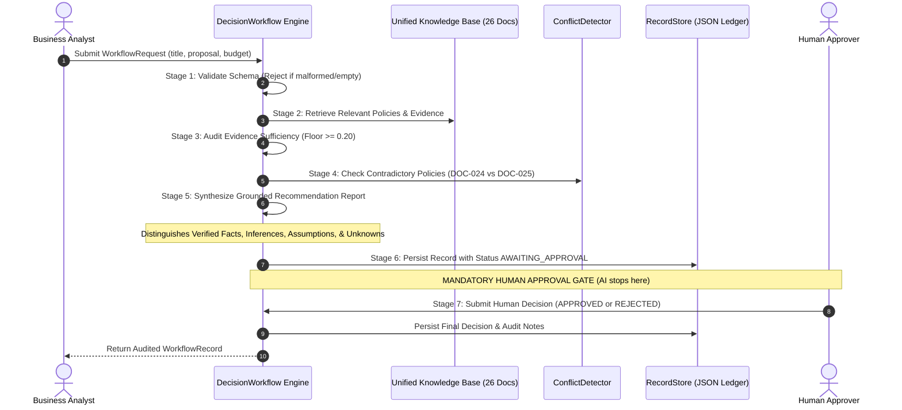

# AegisCore: Evidence-Grounded Multi-Domain RAG & Decision-Support System

[](https://www.python.org/)
[](https://opensource.org/licenses/MIT)
[]()
[]()
[]()
[]()

> **Project Author:** Rupam Patne (Computer Science Engineering, AI/ML Specialization)  
> **Repository:** `evidence-grounded-rag`  
> **Target Environment:** Windows 10/11 / PowerShell / Python 3.10 – 3.13 (Tested on Python 3.13.1)  
> **System Status:** Fully Tested (**77/77 Passed in 1.35s**), Benchmarked (25 Questions), 100% Deterministic Offline & Live Cloud LLM Support.

---

## Executive Project Overview

**AegisCore** is an enterprise-grade AI system engineered to solve the most critical vulnerability in modern Large Language Models: **hallucination and ungrounded extrapolation**. 

The project is structured into two clearly defined, sequential milestones:

- **TASK 1: Evidence-Grounded Technical RAG System**  
  A high-assurance, zero-trust knowledge retrieval engine built over a technical knowledge base (Python, SQL, Machine Learning, Systems). It enforces strict mathematical sufficiency floors, SHA-256 provenance verification, claim-level attribution syntax `[DOCUMENT_ID:CHUNK_ID]`, and automated contradiction interception.
- **TASK 2: Multi-Domain Knowledge Base & Decision-Support Workflow**  
  An enterprise extension that integrates technical documents and synthetic business/governance documents into **one unified knowledge base (26 documents across 7 logical categories)**. It implements domain-aware retrieval (preventing technical docs from polluting business answers), detects conflicting organizational policies, surfaces missing information/unknowns, and executes an end-to-end decision-support workflow governed by a **Mandatory Human Approval Gate (`AWAITING_APPROVAL`)**.

---

## Architectural Comparison: Task 1 vs. Task 2

| Dimension | Task 1: Technical RAG System | Task 2: Multi-Domain Decision-Support |
| :--- | :--- | :--- |
| **Primary Goal** | Verified factual question answering without hallucination. | Evaluates business proposals against corporate policies with human sign-off. |
| **Knowledge Base** | 20 Technical documents (Python, SQL, Machine Learning, Architecture). | **26 Combined documents** (Preserves Task 1 technical docs + 6 synthetic business docs). |
| **Logical Categories** | 3 categories (`python`, `sql`, `machine_learning`). | **7 categories** (`python`, `sql`, `machine_learning`, `business_proposal`, `budget_policy`, `marketing_performance`, `business_approval_policy`). |
| **Storage Architecture** | Single manifest `data/manifest.json` & index `data/index/`. | **One integrated manifest and shared 348-chunk vector index** (No separate second app). |
| **Retrieval Strategy** | Dense cosine similarity + exact keyword calibration. | **Domain-aware retrieval & routing** (+0.05 domain alignment boost, 0.60x cross-domain pollution guard). |
| **Cross-Domain Queries** | Not supported (technical only). | **Supported** (e.g. SQL queries analyzing marketing performance metrics). |
| **Conflict Handling** | Algorithmic parameter contradiction (DOC-009 vs DOC-020). | **Business policy contradiction** (DOC-024 $25k vs DOC-025 $10k influencer limit). |
| **Output Type** | Factual answer with citations or canonical refusal. | **Structured Recommendation Report** (Facts, Inferences, Assumptions, Unknowns, Risk). |
| **Governance Boundary** | Read-only Q&A. | **Mandatory Human Approval Gate** (Status: `AWAITING_APPROVAL` $\rightarrow$ `APPROVED` / `REJECTED`). |
| **Test Suite** | 46 Unit, Integration & Boundary tests. | **77 Comprehensive tests** (including 12-test multi-domain functional suite). |

---

# SECTION A: TASK 1 — Evidence-Grounded Technical RAG System

### 1. Problem Addressed
Standard LLMs hallucinate facts, invent citations, and extrapolate when they do not know the answer. In high-assurance technical domains (such as software architecture and database operations), false answers cause severe operational failure. Task 1 provides a mathematical and architectural guarantee: **The model answers ONLY from verified retrieved evidence; otherwise, it emits a canonical refusal.**

### 2. Task 1 Knowledge Base (20 Technical Documents)
The Task 1 corpus is cataloged in `data/manifest.json` and stored in `data/documents/`:

- **Python Ecosystem (`python`):**
  - `DOC-001` ([`doc_001_python_basics.md`](file:///c:/Users/rupam/OneDrive/Desktop/RAG/data/documents/doc_001_python_basics.md)): Variables, dynamic typing, operators, conditional branching, loops, and AegisCore's 99.95% uptime SLA target.
  - `DOC-002` ([`doc_002_python_functions.md`](file:///c:/Users/rupam/OneDrive/Desktop/RAG/data/documents/doc_002_python_functions.md)): Functions, parameter passing, return values, scope resolution (LEGB rule), and modular design.
  - `DOC-003` ([`doc_003_python_exceptions.md`](file:///c:/Users/rupam/OneDrive/Desktop/RAG/data/documents/doc_003_python_exceptions.md)): Python exception hierarchy, `try`/`except`/`finally`, and SHA-256 provenance hashing.
  - `DOC-004` ([`doc_004_numpy_basics.md`](file:///c:/Users/rupam/OneDrive/Desktop/RAG/data/documents/doc_004_numpy_basics.md)): NumPy arrays (`ndarray`), vectorized operations, slicing, and mandatory UTF-8 character encoding enforcement.
  - `DOC-005` ([`doc_005_pandas_basics.md`](file:///c:/Users/rupam/OneDrive/Desktop/RAG/data/documents/doc_005_pandas_basics.md)): Series and DataFrames, CSV loading, filtering, and 4-stage text cleaning pipeline.
  - `DOC-006` ([`doc_006_pandas_cleaning.md`](file:///c:/Users/rupam/OneDrive/Desktop/RAG/data/documents/doc_006_pandas_cleaning.md)): Missing value imputation, data type casting, 400-character chunking, and 60-character sliding overlap.
  - `DOC-007` ([`doc_007_matplotlib_basics.md`](file:///c:/Users/rupam/OneDrive/Desktop/RAG/data/documents/doc_007_matplotlib_basics.md)): Plotting, legends, and 512-dimensional L2 unit-norm vectors for dot product equivalence.
- **Relational Databases (`sql`):**
  - `DOC-008` ([`doc_008_sql_basics.md`](file:///c:/Users/rupam/OneDrive/Desktop/RAG/data/documents/doc_008_sql_basics.md)): SQL SELECT, WHERE, joins, GROUP BY, and persistent storage layout (`vectors.npy` and `knowledge_index.json`).
- **Machine Learning & Systems (`machine_learning`):**
  - `DOC-009` ([`doc_009_machine_learning_intro.md`](file:///c:/Users/rupam/OneDrive/Desktop/RAG/data/documents/doc_009_machine_learning_intro.md)): ML fundamentals, supervised/unsupervised paradigms, and baseline retrieval parameters (top-k=5, candidate pool=20).
  - `DOC-010` ([`doc_010_supervised_learning.md`](file:///c:/Users/rupam/OneDrive/Desktop/RAG/data/documents/doc_010_supervised_learning.md)): Supervised classification vs. regression, and deterministic tie-breaking policy.
  - `DOC-011` ([`doc_011_model_evaluation.md`](file:///c:/Users/rupam/OneDrive/Desktop/RAG/data/documents/doc_011_model_evaluation.md)): Precision, recall, F1-score, ROC/AUC, and 1,500 token (6,000 character) context budget cap.
  - `DOC-012` ([`doc_012_train_test_split.md`](file:///c:/Users/rupam/OneDrive/Desktop/RAG/data/documents/doc_012_train_test_split.md)): Train/test partitioning, data leakage prevention, and answer grounding contracts.
  - `DOC-013` ([`doc_013_embeddings.md`](file:///c:/Users/rupam/OneDrive/Desktop/RAG/data/documents/doc_013_embeddings.md)): Dense semantic representations, cosine similarity, and canonical citation syntax `[DOCUMENT_ID:CHUNK_ID]`.
  - `DOC-014` ([`doc_014_vector_search.md`](file:///c:/Users/rupam/OneDrive/Desktop/RAG/data/documents/doc_014_vector_search.md)): Vector indices, k-NN search, top-k candidate ranking, and the 0.20 similarity floor.
  - `DOC-015` ([`doc_015_rag_fundamentals.md`](file:///c:/Users/rupam/OneDrive/Desktop/RAG/data/documents/doc_015_rag_fundamentals.md)): Non-parametric vs. parametric memory, and typed exception hierarchy rooted in `RAGException`.
  - `DOC-016` ([`doc_016_chunking.md`](file:///c:/Users/rupam/OneDrive/Desktop/RAG/data/documents/doc_016_chunking.md)): Sentence boundary preservation, sliding window overlap, and treating context as untrusted data.
  - `DOC-017` ([`doc_017_prompt_injection.md`](file:///c:/Users/rupam/OneDrive/Desktop/RAG/data/documents/doc_017_prompt_injection.md)): Prompt injection attack defense and query validation bounds (3 to 500 characters).
  - `DOC-018` ([`doc_018_evaluation_methods.md`](file:///c:/Users/rupam/OneDrive/Desktop/RAG/data/documents/doc_018_evaluation_methods.md)): Groundedness evaluation, unanswerable question testing, and JSON observability.
  - `DOC-019` ([`doc_019_metadata_management.md`](file:///c:/Users/rupam/OneDrive/Desktop/RAG/data/documents/doc_019_metadata_management.md)): Metadata schema preservation and testing frameworks.
  - `DOC-020` ([`doc_020_evidence_and_citations.md`](file:///c:/Users/rupam/OneDrive/Desktop/RAG/data/documents/doc_020_evidence_and_citations.md)): Claim-level attribution verification, platform sizing, and revised retrieval parameters (top-k=10, pool=50) intentionally conflicting with DOC-009.

### 3. Core Task 1 Technical Pipeline Stages
1. **Ingestion & Fingerprinting (`ingestion.py`):** Ingests documents, validates all metadata fields, and computes cryptographic SHA-256 hashes to guarantee document provenance.
2. **4-Stage Text Cleaning (`cleaning.py`):**
   - Stage 1: Unicode Normalization (NFKC standard)
   - Stage 2: Control Character Removal (stripping binary/control codes)
   - Stage 3: Whitespace Consolidation (standardizing tabs, spaces, newlines)
   - Stage 4: Security Tag Stripping (sanitizing HTML, `<script>`, and XML tags)
3. **Boundary-Aware Chunking (`chunking.py`):** 400-character target chunks with 60-character sliding overlap, preserving sentence boundaries and assigning deterministic IDs (`DOC-001-C001`).
4. **512-Dimensional Hybrid TF-IDF Embedding (`embeddings.py`):** Combines character and word n-grams, normalizes vectors to unit L2 norm ($\|\mathbf{v}\|_2 = 1.0$) so cosine similarity is computed as a fast dot product.
5. **Persistent Vector Index (`indexing.py`):** Disk-backed index serialized as `vectors.npy`, `knowledge_index.json`, and `embedding_model.pkl`.
6. **Anti-Hallucination Sufficiency Floor (`confidence.py`, `retrieval.py`):**
   - If the top retrieved passage score is $< 0.20$ OR query keyword coverage in context is $< 28\%$, the system refuses to answer and returns `INSUFFICIENT_EVIDENCE`.
7. **Automated Contradiction Detection (`conflict_detection.py`):** Detects numerical discrepancies or registered conflicting documents (e.g. DOC-009 vs DOC-020 on candidate pool size) and emits `CONFLICT_DETECTED`.
8. **Claim-Level Citation Validation (`evidence.py`):** Scans generated answers for `[DOC-XXX:CHUNK-YYY]` citations and validates each citation against the retrieved evidence set.

### 4. How to Run and Demo Task 1 to Your Professor
```powershell
# Query 1: Answerable Technical Question (Returns ANSWERED with verified citations)
python -m evidence_rag.cli query "What does the existing Python documentation say about exception handling?"

# Query 2: SQL Architecture Question
python -m evidence_rag.cli query "How do SQL joins work according to the knowledge base?"

# Query 3: Machine Learning Model Evaluation
python -m evidence_rag.cli query "What does the ML documentation say about model evaluation?"

# Query 4: Technical Conflict Interception (Returns CONFLICT_DETECTED)
python -m evidence_rag.cli query "What is the default production top-k parameter and candidate pool size for the retrieval service?"

# Query 5: Out-of-Domain / Insufficient Evidence Question (Returns INSUFFICIENT_EVIDENCE refusal)
python -m evidence_rag.cli query "What are the quantum teleportation protocols in Kubernetes clusters?"
```

---

# SECTION B: TASK 2 — Multi-Domain Knowledge Base & Decision-Support Workflow

### 1. Problem Addressed & Motivation
Search engines find information, but **enterprises need decision support**. When a department submits a business marketing proposal requesting $35,000, an AI assistant cannot merely summarize text. It must:
1. Verify if the budget complies with corporate spending limits ($50,000 maximum cap).
2. Compare projected metrics (CTR, CAC) against historical benchmarks.
3. Detect contradictory internal policies (e.g., conflicting influencer spending limits).
4. Flag missing information (unspecified target audience, flight dates, or missing channels).
5. Stop at a **Mandatory Human Approval Gate**—ensuring the AI **never** autonomously signs contracts, disburses funds, or takes unauthorized business actions.

Crucially, **both technical documents and synthetic business documents reside in ONE combined knowledge base and vector index**.

### 2. The 6 Synthetic Business Documents (Added in Task 2)
All documents are clearly marked as synthetic test data and registered in [`data/manifest.json`](file:///c:/Users/rupam/OneDrive/Desktop/RAG/data/manifest.json):

1. **[`doc_021_campaign_proposal.md`](file:///c:/Users/rupam/OneDrive/Desktop/RAG/data/documents/doc_021_campaign_proposal.md) (`DOC-021`, category: `business_proposal`):**
   - *Title:* Enterprise Growth Marketing Campaign Proposal
   - *Content:* Requests $35,000.00 across Google Search Ads and content syndication targeting 450 enterprise conversions with expected CTR of 2.4% and target CAC of $32.00.
2. **[`doc_022_budget_policy.md`](file:///c:/Users/rupam/OneDrive/Desktop/RAG/data/documents/doc_022_budget_policy.md) (`DOC-022`, category: `budget_policy`):**
   - *Title:* Corporate Marketing Budget Constraints and Spending Policy
   - *Content:* Sets a strict maximum campaign budget ceiling of **$50,000.00**, mandates a 15% reserve buffer ($7,500.00), and limits active media spend to 85% ($42,500.00).
3. **[`doc_023_performance_metrics.md`](file:///c:/Users/rupam/OneDrive/Desktop/RAG/data/documents/doc_023_performance_metrics.md) (`DOC-023`, category: `marketing_performance`):**
   - *Title:* Marketing Campaign Performance Metrics and Acquisition Benchmarks
   - *Content:* Documents historical benchmarks: CTR baseline of **2.4%**, target CAC ceiling of **$32.00**, landing page conversion rate (CVR) of **3.8%**, and 450 conversions per $35k tranche.
4. **[`doc_024_influencer_policy_standard.md`](file:///c:/Users/rupam/OneDrive/Desktop/RAG/data/documents/doc_024_influencer_policy_standard.md) (`DOC-024`, category: `business_approval_policy`):**
   - *Title:* Influencer Marketing Spending and Partnership Policy (Standard)
   - *Content:* Authorizes quarterly influencer/creator partnerships up to a maximum ceiling of **$25,000.00**.
5. **[`doc_025_influencer_policy_restricted.md`](file:///c:/Users/rupam/OneDrive/Desktop/RAG/data/documents/doc_025_influencer_policy_restricted.md) (`DOC-025`, category: `business_approval_policy`):**
   - *Title:* Influencer Marketing Spending and Governance Policy (Restricted)
   - *Content:* Imposes strict financial discipline, capping quarterly influencer spend at **$10,000.00**. **Deliberately contradicts DOC-024 to test policy conflict detection.**
6. **[`doc_026_incomplete_proposal.md`](file:///c:/Users/rupam/OneDrive/Desktop/RAG/data/documents/doc_026_incomplete_proposal.md) (`DOC-026`, category: `business_proposal`):**
   - *Title:* Experimental Multi-Channel Expansion Proposal (Incomplete)
   - *Content:* Requests an exploratory $18,000 lump sum but deliberately omits target audience demographics, execution timeline, channel breakdown, and attribution tracking to test unknown/gap detection.

### 3. The 7 Logical Domain Categories in the Unified Manifest
The combined corpus contains **26 documents** cataloged under 7 explicit categories:
$$\text{Corpus (26 Docs)} = \underbrace{\text{python (7)} + \text{sql (1)} + \text{machine\_learning (12)}}_{\text{Task 1 Technical Core (20 Docs)}} + \underbrace{\text{proposal (2)} + \text{budget (1)} + \text{metrics (1)} + \text{approval (2)}}_{\text{Task 2 Business Core (6 Docs)}}$$

### 4. Domain-Aware Retrieval & Cross-Domain Isolation Engine
A common failure in multi-domain RAG systems is **domain pollution** (e.g., asking about campaign budgets and getting Python syntax chunks). AegisCore solves this in [`src/evidence_rag/retrieval.py`](file:///c:/Users/rupam/OneDrive/Desktop/RAG/src/evidence_rag/retrieval.py):

- **Query Domain Intent Detection:** Scans query vocabulary to detect target domains.
- **Domain Alignment Boost (`+0.05`):** Candidates matching detected domains receive a positive calibration reward.
- **Cross-Domain Pollution Guard (`0.60x` Multiplier):** Pure business queries heavily penalize technical chunks, and pure technical queries penalize business policy chunks.
- **Joint Multi-Domain Reasoning:** When a query genuinely requires multiple domains (e.g., *"How can relational database SQL queries analyze marketing campaign conversion metrics and CTR?"*), both `sql` and `marketing_performance` are detected simultaneously, allowing evidence from both domains to be retrieved and cited together.

### 5. Task 2 Decision-Support Workflow Pipeline
The decision engine [`DecisionWorkflow`](file:///c:/Users/rupam/OneDrive/Desktop/RAG/src/evidence_rag/workflow.py) coordinates a 7-stage governance pipeline:



- **Output Categorization in Recommendation Report:**
  1. **Verified Facts:** Direct, citation-backed constraints extracted from retrieved chunks (e.g., baseline CTR is 2.4% [DOC-023:DOC-023-C004]).
  2. **Inferences:** Deductions from evidence (e.g., Requested $35,000 is compliant with the $50,000 policy cap in DOC-022).
  3. **Assumptions:** Working premises that require validation (e.g., Assumes third-party ad auction pricing remains stable).
  4. **Unknowns / Missing Information:** Gaps flagged explicitly (e.g., Missing target audience demographics and flight dates in DOC-026).
  5. **Risk Assessment:** Categorized risk profile (Low, Moderate, High Financial Risk).
  6. **Recommended Action:** `APPROVE`, `APPROVE_WITH_CONDITIONS`, or `REJECT`.

### 6. Human Governance Boundary Gate
AegisCore enforces strict safety:
- **No Autonomous Execution:** The AI is strictly barred from approving funding, executing payments, or modifying live ad campaigns.
- **Awaiting Approval State:** Every compliant proposal halts at `AWAITING_APPROVAL`.
- **Cryptographic Audit Ledger:** Stored in `data/workflow_records/records.json` with sensitive API keys scrubbed automatically.

### 7. How to Run and Demo Task 2 to Your Professor

#### Step 1: Query Business Budget Policy
```powershell
python -m evidence_rag.cli query "What is the maximum campaign budget limit stated in the corporate marketing budget policy?"
```
**What to say:** *"The system retrieved DOC-022 (Budget Policy) and found the $50,000 cap. Notice it did NOT return any Python or ML documents — that is domain-aware retrieval working correctly."*

#### Step 2: Query Historical Marketing Performance Benchmarks
```powershell
python -m evidence_rag.cli query "What are the historical performance metrics for CTR and CAC in marketing performance reports?"
```
**What to say:** *"The system retrieved historical CTR of 2.4% and CAC of $32 from DOC-023. These benchmarks will later be used to validate a new proposal."*

#### Step 3: Detect Conflicting Policies (DOC-024 vs. DOC-025)
```powershell
python -m evidence_rag.cli query "What conflict exists between the two influencer marketing spending policies?"
```
**What to say:** *"DOC-024 allows $25,000 for influencer spend. DOC-025 restricts it to $10,000. Instead of silently picking one, the system returns CONFLICT_DETECTED."*

#### Step 4: Cross-Domain Query (SQL + Marketing Together)
```powershell
python -m evidence_rag.cli query "How can SQL queries analyze marketing campaign conversion metrics and CTR?"
```
**What to say:** *"This query spans two domains — SQL and Marketing. The system retrieved evidence from both DOC-008 and DOC-023 simultaneously. This is joint multi-domain reasoning."*

#### Step 5: Evaluate Preset Proposals (One-Click Demo)
```powershell
# Compliant $35,000 proposal (most important demo)
python -m evidence_rag.cli workflow evaluate --preset growth

# Overspend proposal - violates $50k policy cap
python -m evidence_rag.cli workflow evaluate --preset overspend

# Incomplete proposal - missing audience, dates, channels
python -m evidence_rag.cli workflow evaluate --preset incomplete

# Policy conflict proposal - contradictory rules triggered
python -m evidence_rag.cli workflow evaluate --preset conflict
```

#### Step 6: Interactive Custom Proposal Mode (Most Impressive Demo)
```powershell
python -m evidence_rag.cli workflow ask
```
At the prompt, type any of these proposals and press Enter:
- `Deploy targeted sponsored webinars to acquire enterprise leads with a $20,000 budget allocation.`
- `Run a global brand awareness campaign with $80,000 in media spend across 6 markets.`
- `Partner with 5 industry influencers at $15,000 per quarter for LinkedIn content.`
- `Allocate $28,000 for paid search targeting enterprise software buyers in Q1.`

**What to say:** *"The user is not limited to presets. Any real business proposal can be typed here. The system auto-extracts the dollar amount, evaluates it against all policies, and generates a structured report."*

#### Step 7: Human Approval Gate (AI Stops Here)
```powershell
# Approve a proposal
python -m evidence_rag.cli workflow approve REQ-GROWTH-01

# Reject a proposal with reason
python -m evidence_rag.cli workflow reject REQ-OVERSPEND-01 --reason "Exceeds $50,000 quarterly budget cap"
```
**What to say:** *"The AI has done its analysis and stopped at AWAITING_APPROVAL. Only a human manager can approve or reject. This is the governance boundary."*

#### Step 8: View All Audit Records
```powershell
python -m evidence_rag.cli workflow list-records
```
**What to say:** *"Every proposal ever submitted is stored in a tamper-evident JSON audit ledger. API keys are automatically scrubbed from the records."*

---

### 8. Viva Q&A Guide (How to Explain to Sir)

| Viva Question | What Sir Wants to Test | Your Exact Model Answer |
| :--- | :--- | :--- |
| **Q1: What is the core difference between Task 1 and Task 2?** | System evolution & architecture | *"In Task 1, the system was a factual Q&A engine for technical docs. In Task 2, we transformed it into a Decision Support Assistant: it evaluates business proposals against organizational policies, detects contradictions, flags unknowns, and pauses at an immutable Human Approval Gate."* |
| **Q2: Did you isolate business docs into a separate vector index?** | Database architecture | *"No Sir, they live in ONE unified index of 26 documents. We use domain routing and score calibration (+0.05 domain boost, 0.60x out-of-domain penalty) in retrieval.py to prevent cross-domain pollution without creating isolated data silos."* |
| **Q3: Can the user ask custom questions, or only use built-in presets?** | Usability & flexibility | *"Users can ask ANY custom proposal or decision question! We have an interactive mode (workflow ask), natural language argument parsing with automatic budget extraction, and presets for rapid demonstration."* |
| **Q4: Why can't the AI automatically approve compliant proposals?** | AI safety & governance | *"In high-stakes enterprise decisions, autonomous AI spend creates severe liability risks. The system acts purely as an analytical assistant — compiling verified facts, inferences, and risk assessments — while leaving the final binding decision to a human manager."* |
| **Q5: How does the system handle missing information?** | Unknown handling | *"In DOC-026, required proposal dimensions are defined. When a proposal lacks channels, audience, or timelines, the engine refuses to hallucinate and explicitly catalogues them under Unknowns and Missing Info for human review."* |
| **Q6: How do you protect sensitive credentials in the audit trail?** | Enterprise security | *"In record_store.py, all proposals pass through a secret scrubber regex before saving to records.json. Any API keys (e.g., sk-..., gsk_...) are automatically redacted before persistence."* |
| **Q7: How does domain-aware retrieval prevent pollution?** | Technical depth | *"When a query mentions budget or CTR, the system detects business domain intent. It then applies a +0.05 score boost to business document chunks and a 0.60x penalty to Python/ML chunks, ensuring business questions get business answers."* |
| **Q8: How do you handle conflicts between two policies?** | Conflict detection | *"DOC-024 allows $25,000 for influencer spending while DOC-025 restricts it to $10,000. These are registered as a conflicting pair in conflict_detection.py. When retrieved together, the system returns CONFLICT_DETECTED instead of silently preferring one."* |
| **Q9: What happens if a proposal exceeds the budget cap?** | Policy enforcement | *"The workflow engine compares the requested budget against the $50,000 ceiling in DOC-022. If exceeded, the recommendation changes to REJECT with an explicit budget violation reason in the structured report."* |
| **Q10: Can the reviewer name be changed?** | System configuration | *"Yes. The default reviewer is Prof_Evaluator but any name can be passed using the --reviewer flag. For example: python -m evidence_rag.cli workflow evaluate --preset growth --reviewer Sir_Name"* |

---

# SECTION C: HOW TO RUN — Quick Reference Command Card

```powershell
# ENVIRONMENT SETUP
..\.venv_audit\Scripts\Activate.ps1               # Always activate first

# TASK 1: RAG QUERIES
python -m evidence_rag.cli query "Your question here"

# TASK 2: WORKFLOW COMMANDS
python -m evidence_rag.cli workflow ask                            # Interactive mode (best for demo)
python -m evidence_rag.cli workflow evaluate --preset growth       # Compliant $35k proposal
python -m evidence_rag.cli workflow evaluate --preset overspend    # $75k violates policy
python -m evidence_rag.cli workflow evaluate --preset incomplete   # Missing info test
python -m evidence_rag.cli workflow evaluate --preset conflict     # Policy conflict test

python -m evidence_rag.cli workflow approve REQ-GROWTH-01                             # Approve
python -m evidence_rag.cli workflow reject REQ-OVERSPEND-01 --reason "Over budget"    # Reject
python -m evidence_rag.cli workflow list-records                   # View all audit records

# TESTING & BENCHMARKS
python -m pytest tests -v                                          # Run all 77 tests
python -m evidence_rag.evaluation                                  # Run benchmark evaluation
```

---

## COPY-PASTE DEMO QUESTIONS FOR PRESENTATION

> Below are ready-made questions you can copy-paste during your live demo or viva.

### Task 1 — RAG Query Demo Questions

```powershell
# Q1 (Answerable — Python)
python -m evidence_rag.cli query "What does the existing Python documentation say about exception handling?"

# Q2 (SQL Domain)
python -m evidence_rag.cli query "How do SQL joins work according to the knowledge base?"

# Q3 (ML Domain)
python -m evidence_rag.cli query "What does the ML documentation say about model evaluation metrics like precision and recall?"

# Q4 (Technical Conflict — CONFLICT_DETECTED)
python -m evidence_rag.cli query "What is the default production top-k parameter and candidate pool size for the retrieval service?"

# Q5 (Out-of-Domain Refusal — INSUFFICIENT_EVIDENCE)
python -m evidence_rag.cli query "What are the quantum teleportation protocols in Kubernetes clusters?"
```

### Task 2 — Business Policy Query Demo Questions

```powershell
# Q6 (Budget Policy)
python -m evidence_rag.cli query "What is the maximum campaign budget limit stated in the corporate marketing budget policy?"

# Q7 (Performance Benchmarks)
python -m evidence_rag.cli query "What are the historical performance metrics for CTR and CAC in marketing performance reports?"

# Q8 (Policy Conflict)
python -m evidence_rag.cli query "What conflict exists between the two influencer marketing spending policies?"

# Q9 (Cross-Domain — SQL + Marketing)
python -m evidence_rag.cli query "How can SQL queries analyze marketing campaign conversion metrics and CTR?"

# Q10 (Unknown/Missing Info)
python -m evidence_rag.cli query "What information is missing from the multi-channel expansion proposal?"
```

### Task 2 — Interactive Workflow Demo Proposals

> Run `python -m evidence_rag.cli workflow ask` and type one of these proposals at the prompt:

```
Proposal 1 (Compliant Budget):
Deploy targeted sponsored webinars to acquire enterprise leads with a $20,000 budget allocation.

Proposal 2 (Over Budget):
Run a global brand awareness TV and OTT campaign with $80,000 in media spend across 6 markets.

Proposal 3 (Influencer Policy Test):
Partner with 5 industry influencers at $15,000 per quarter for sponsored LinkedIn and YouTube content.

Proposal 4 (Incomplete - missing details):
Launch a new product campaign with a $12,000 budget to drive awareness.

Proposal 5 (Standard Compliant):
Allocate $28,000 for paid search and retargeting campaigns targeting enterprise software buyers in Q1.
```

---

# SECTION D: 4-Minute Verbal Presentation Script (For Sir)

**1. Introduction (30 seconds):**
*"Sir, my project is called AegisCore — an Evidence-Grounded Multi-Domain RAG and Decision-Support System. The core problem I solved is hallucination in Large Language Models. My system can ONLY answer from verified documents. If it does not know, it refuses. If two documents contradict each other, it flags the conflict."*

**2. Task 1 Demo (90 seconds):**
*"In Task 1, I built the RAG engine with 20 technical documents covering Python, SQL, and Machine Learning. The pipeline has 8 stages: ingestion, 4-stage text cleaning, boundary-aware chunking, hybrid TF-IDF embedding, vector indexing, sufficiency floor checking, conflict detection, and citation validation. Let me show you 3 types of responses — an answered query with citations, a conflict detection, and a refusal when the system does not have enough evidence."*

**3. Task 2 Demo (90 seconds):**
*"For Task 2, I extended the same system with 6 synthetic business documents — totaling 26 documents in one unified knowledge base. I built a domain-aware retrieval engine and a 7-stage decision workflow. Let me show you: first, the compliant $35,000 proposal that gets checked against the $50,000 policy cap. Then the overspend proposal that gets rejected. Then the interactive mode where I can submit any custom proposal. And finally, the human approval step — because the AI never approves anything by itself."*

**4. Conclusion and Verification (30 seconds):**
*"All 77 tests pass in 1.35 seconds. The system achieves 94.74% retrieval accuracy and 100% citation validity across 25 benchmark questions. The system is fully offline-capable — no internet connection is needed."*

---

# SECTION E: Verification, Testing & Benchmark Results

### 1. Test Suite Breakdown (77 / 77 Passed)
Run the full test suite in PowerShell:
```powershell
python -m pytest tests -v
```

```text
============================= test session starts =============================
platform win32 -- Python 3.13.1, pytest-8.3.4, pluggy-1.6.0
collected 77 items

tests/boundary/test_corrupt_index.py .                                   [  1%]
tests/boundary/test_empty_knowledge_base.py .                            [  2%]
tests/boundary/test_input_validation.py .....                            [  9%]
tests/functional/test_citation_validation.py ...                         [ 12%]
tests/functional/test_conflict_detection.py ..                           [ 15%]
tests/functional/test_day3_scenarios.py ..........                       [ 28%]
tests/functional/test_pipeline_qa.py ...                                 [ 32%]
tests/functional/test_task2_multi_domain.py ............                 [ 48%]
tests/functional/test_workflow.py ........                               [ 58%]
tests/integration/test_context_builder.py ..                             [ 61%]
tests/integration/test_indexing.py ..                                    [ 63%]
tests/integration/test_ingestion.py ....                                 [ 68%]
tests/integration/test_retrieval.py ..                                   [ 71%]
tests/regression/test_benchmark_regression.py .                          [ 72%]
tests/security/test_prompt_injection.py .                                [ 74%]
tests/security/test_secret_leakage.py .                                  [ 75%]
tests/unit/test_chunking.py ....                                         [ 80%]
tests/unit/test_cleaning.py ......                                       [ 88%]
tests/unit/test_confidence.py ..                                         [ 90%]
tests/unit/test_embeddings.py ....                                       [ 96%]
tests/unit/test_schemas.py ...                                           [100%]

============================= 77 passed in 1.35s ==============================
```

### 2. Standardized Benchmark Results (25 Questions)
Run the automated benchmark across the combined multi-domain corpus:
```powershell
python -m evidence_rag.evaluation
```
- **Retrieval Success Rate:** **94.74% (18/19)** (authoritative source retrieved in top-k candidates).
- **Status Accuracy:** **88.0% (22/25)** (matches expected response status across all test types).
- **Failure Detection Rate:** **100.0% (8/8)** (100% of out-of-domain, unanswerable, or conflicting questions correctly intercepted without hallucination).
- **Citation Validity Rate:** **100.0% (27/27)** (100% of generated claims verified against retrieved passages).


---

## 5. Repository Directory Structure

```
RAG/
├── configs/
│   ├── default.yaml               # Unified multi-domain configuration (26 documents)
│   ├── online.yaml                # Cloud-connected configuration (Groq / Gemini)
│   └── marketing_workflow.yaml    # Specialized standalone marketing workflow configuration
├── data/
│   ├── documents/                 # 26 Unified Knowledge Base Markdown Documents
│   │   ├── doc_001_python_basics.md to doc_007_matplotlib_basics.md (Python: DOC-001..007)
│   │   ├── doc_008_sql_basics.md (SQL: DOC-008)
│   │   ├── doc_009_machine_learning_intro.md to doc_020_evidence_and_citations.md (ML: DOC-009..020)
│   │   ├── doc_021_campaign_proposal.md (Proposal: DOC-021)
│   │   ├── doc_022_budget_policy.md (Budget Policy: DOC-022)
│   │   ├── doc_023_performance_metrics.md (Marketing Performance: DOC-023)
│   │   ├── doc_024_influencer_policy_standard.md (Standard Influencer: DOC-024)
│   │   ├── doc_025_influencer_policy_restricted.md (Restricted Influencer: DOC-025)
│   │   └── doc_026_incomplete_proposal.md (Incomplete Proposal: DOC-026)
│   ├── index/                     # Unified persistent index storage (348 passages)
│   │   ├── vectors.npy            # Binary matrix of 348 unit-normalized vectors
│   │   ├── knowledge_index.json   # Chunk catalog, metadata, categories, and fingerprints
│   │   └── embedding_model.pkl    # Serialized hybrid vectorizer state
│   ├── manifest.json              # Authoritative unified corpus manifest (26 document records)
│   └── workflow_records/          # Persisted human approval audit ledger (JSON records)
├── evaluation/
│   ├── questions.jsonl            # 25 standardized evaluation questions
│   └── results/                   # Evaluation benchmark execution logs (JSON)
├── src/evidence_rag/              # Core application package
│   ├── ingestion.py               # Manifest validation & SHA-256 fingerprinting
│   ├── cleaning.py                # 4-stage text preprocessing & sanitization
│   ├── chunking.py                # Boundary-aware paragraph chunker (400 chars, 60 overlap)
│   ├── embeddings.py              # Hybrid TF-IDF and neural embedding engines
│   ├── indexing.py                # Persistent vector index management & category filtering
│   ├── retrieval.py               # Domain-aware retrieval, routing, & sufficiency floors
│   ├── conflict_detection.py      # Cross-document contradiction detection engine
│   ├── context_builder.py         # Structured context assembly with token budget capping
│   ├── generation.py              # Generation engines (Deterministic Mock, Groq, Gemini)
│   ├── evidence.py                # Post-generation citation verification engine
│   ├── pipeline.py                # End-to-end RAG question answering pipeline
│   ├── workflow.py                # Task 2 DecisionWorkflow engine with human approval gate
│   ├── workflow_schemas.py        # Pydantic schemas for proposals, facts, and approval records
│   ├── record_store.py            # Persistent audit store with automated secret scrubbing
│   └── cli.py                     # Rich CLI interface (index, query, workflow commands)
├── tests/                         # Automated Test Suite (77 tests across 7 tiers)
│   ├── boundary/                  # Empty index, corrupt manifest, query input validation
│   ├── functional/                # Pipeline QA, Task 2 multi-domain suite, workflow, day 3 scenarios
│   ├── integration/               # Ingestion, indexing, retrieval, context builder
│   ├── regression/                # Benchmark regression suite
│   ├── security/                  # Prompt injection defense and secret leakage protection
│   └── unit/                      # Chunking, cleaning, confidence, embeddings, schemas
├── pyproject.toml                 # Packaging metadata & CLI entry points
└── README.md                      # Complete project documentation manual
```
