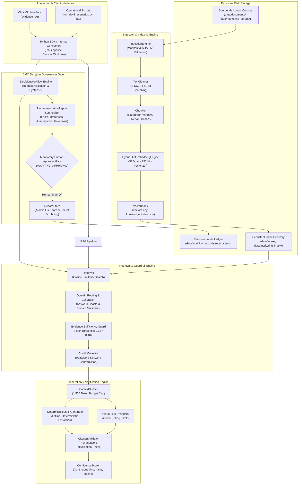
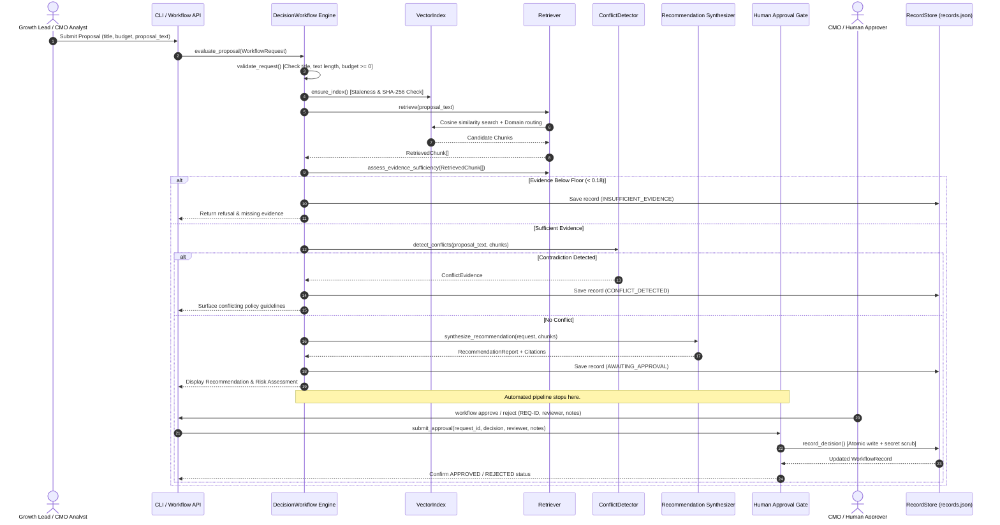
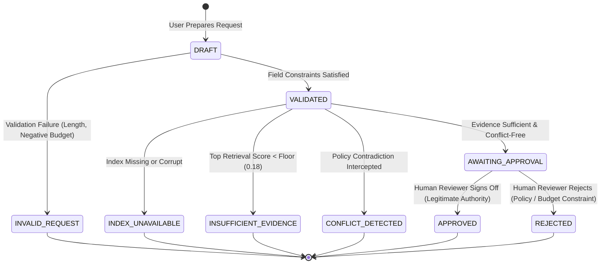
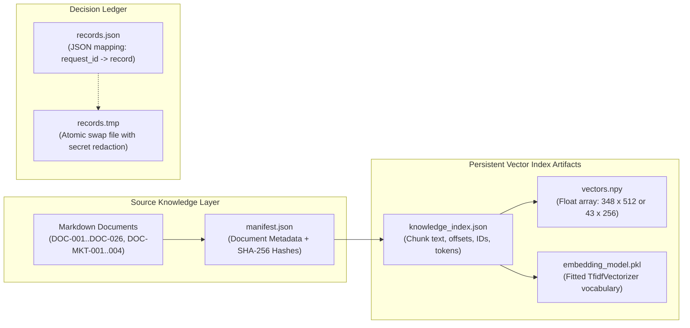

# Architecture Overview Report

**Project:** BHIV CMO Technical Execution Assignment v2 — Existing RAG System Architecture  
**Date:** 2026-11-11  

---

## 1. Architectural Philosophy & Design Principles

The existing system (**AegisCore**) implements a **Zero-Trust Evidence-Grounded Architecture**. Unlike conventional RAG systems that treat language models as generative synthesizers prone to parametric hallucination, this architecture enforces the following principles:

1. **Deterministic Attribution Syntax:** Every factual claim emitted must include a machine-verifiable citation token `[DOCUMENT_ID:CHUNK_ID]` referencing an exact retrieved passage.
2. **Mathematical Sufficiency Floors:** If semantic retrieval confidence fails to exceed configured similarity floors ($\ge 0.25$ for technical QA, $\ge 0.18$ for CMO proposals), generation is blocked immediately and a canonical refusal is emitted.
3. **Automated Conflict Interception:** Contradictory corporate policies or technical instructions are detected prior to response generation, surfacing tensions transparently rather than averaging contradictory facts.
4. **Mandatory Human Governance Gate:** For high-stakes CMO decisions (e.g. ad spend, creator contracts, growth initiatives), the automated pipeline terminates at state `AWAITING_APPROVAL`. The system cannot commit external funds or approve proposals autonomously.

---

## 2. Mermaid Architecture Diagrams

### 2.1 System Component Topology

---

### 2.2 End-to-End Proposal Evaluation Sequence Flow

---

### 2.3 Human Governance Approval State Machine

---

### 2.4 Data Storage & Index Artifact Layout

---

## 3. Subsystem Breakdown & Module Responsibilities

| Module | Core Classes / Functions | Primary Responsibility |
| :--- | :--- | :--- |
| `src/evidence_rag/ingestion.py` | `IngestionEngine` | Ingests documents declared in corpus `manifest.json`. Validates metadata completeness (8 required fields), detects duplicate IDs, and verifies SHA-256 content hashes. |
| `src/evidence_rag/cleaning.py` | `TextCleaner`, `clean_text` | 4-stage text preprocessing: Unicode NFKC normalization, HTML/script tag stripping, control character removal, PII/secret redaction, and whitespace consolidation. |
| `src/evidence_rag/chunking.py` | `Chunker` | Boundary-aware paragraph chunking with sentence splitting fallback for long passages. Enforces 400-char target size, 60-char overlap, and stable IDs (`CHUNK-{doc_id}-{index:03d}`). |
| `src/evidence_rag/embeddings.py` | `HybridTfidfEmbeddingEngine`, `BaseEmbeddingEngine` | Produces L2-normalized 512-dim (or 256-dim) representations using sublinear TF-IDF and n-grams (1, 2). Completely offline and deterministic. Supports optional neural embeddings. |
| `src/evidence_rag/indexing.py` | `VectorIndex` | In-memory and disk-backed vector storage. Computes exact cosine similarity matrix dot products. Serializes `vectors.npy`, `knowledge_index.json`, and `embedding_model.pkl`. |
| `src/evidence_rag/retrieval.py` | `Retriever` | Cosine similarity candidate retrieval with domain-aware routing (+0.05 domain boost, 0.60x cross-domain guard), exact keyword boost calibration, and mathematical sufficiency checking. |
| `src/evidence_rag/conflict_detection.py`| `ConflictDetector` | Scans retrieved passages for documented contradictory pairings (e.g. DOC-MKT-002 vs DOC-MKT-004 spend caps, DOC-009 vs DOC-020 pool sizes) using keyword/number heuristics. |
| `src/evidence_rag/context_builder.py` | `ContextBuilder` | Assembles retrieved evidence passages into formatted context blocks. Strictly enforces a 1,500 token budget cap to prevent context window overflow. |
| `src/evidence_rag/generation.py` | `DeterministicMockGenerator`, `GeminiGenerator`, `GroqGenerator`, `GrokGenerator` | Generates grounded responses with explicit citation tokens. Defaults to zero-latency offline mock extraction, with optional live LLM fallback. |
| `src/evidence_rag/evidence.py` | `CitationValidator` | Extracts citation tokens using regex and validates every cited chunk against the retrieved evidence set. Flags ungrounded citations. |
| `src/evidence_rag/confidence.py` | `ConfidenceScorer` | Calculates continuous confidence score (0.00 to 1.00) and compiles structured limitations list based on retrieval scores, margins, and conflict flags. |
| `src/evidence_rag/pipeline.py` | `RAGPipeline` | Master orchestrator for Task 1 technical question answering queries. |
| `src/evidence_rag/workflow.py` | `DecisionWorkflow` | Master orchestrator for Task 2 CMO proposal evaluation, recommendation synthesis, and managerial approval gate. |
| `src/evidence_rag/record_store.py` | `RecordStore` | Thread-safe, atomic disk storage for workflow transaction logs with automated API secret scrubbing. |
| `src/evidence_rag/cli.py` | Click command tree (`main`, `index`, `query`, `workflow`, etc.) | Rich terminal user interface providing human operators with query, evaluation, approval, and replay controls. |

---

## 4. Key Architectural Strengths & Structural Gaps

### Architectural Strengths
- **Decoupled Pipeline:** Clear separation of concerns between ingestion, indexing, retrieval, evaluation, and governance.
- **Deterministic Offline Replayability:** Offline test suite executes in ~6.3s without external API dependencies or network calls.
- **Fail-Safe Governance:** Built-in impossibility of automated spend authorization; proposals remain in `AWAITING_APPROVAL` until signed off.
- **Comprehensive Traceability:** Every recommendation records source document IDs, chunk IDs, and character offsets.

### Structural Gaps for Enterprise CMO Deployment
- **No HTTP / REST Web API:** Current interactions require local CLI or Python scripting. Cannot be consumed directly by external frontend portals without adding FastAPI/Starlette endpoints.
- **Unauthenticated Reviewer Identities:** Approval gate records plain text reviewer strings (`reviewer: str`) without cryptographic signatures or session tokens.
- **Heuristic Contradiction Detection:** Conflict detection is driven by registered pairs and keyword matching rather than general semantic Natural Language Inference (NLI).
