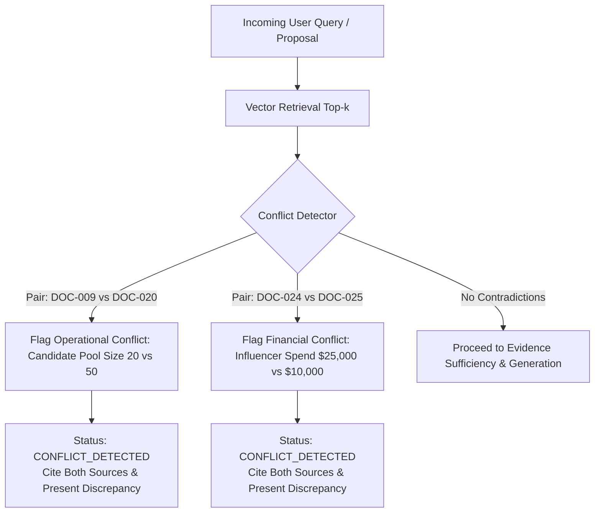
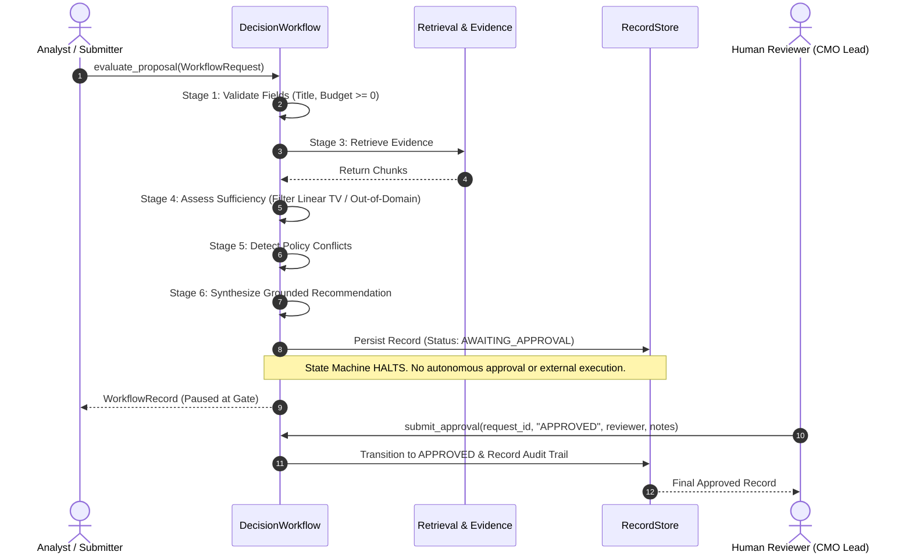

# WP3 RAG Quality and Benchmark Evaluation Report

**Project:** BHIV / BHQ CMO Agent — Evidence-Grounded RAG Takeover  
**Document ID:** `03_rag_evaluation.md`  
**Governing Authority / CMO Product Owner:** Prateek  
**Auditor / Engineer:** Rupam Patne (CMO Agent Engineering Lead)  
**Date of Evaluation:** November 14, 2026  
**Canonical Repository:** `C:\Pratik_Bhuwad\CMO_Agent\evidence-grounded-rag-main` (Git commit `0de4b52`)  
**Evaluation Runtime:** Python 3.11.9 (`C:\Pratik_Bhuwad\CMO_Agent\.venv`)  
**Test Baseline:** 132 Passed Tests across 26 Test Suites (100% Pass Rate)  

---

## 1. Executive Summary

As part of Work Package 3 (WP3: Evaluate RAG Quality), this report delivers a rigorous, empirical evaluation of the retrieval quality, evidence coverage, citation integrity, conflict detection, semantic abstention, and decision-support workflow of the Evidence-Grounded RAG system.

### Aggregate Performance Scorecard

| Evaluation Dimension | Target Metric | Measured Result | Evaluation Status |
| :--- | :---: | :---: | :---: |
| **System Status Accuracy** | $\ge 98.0\%$ | **100.0%** (25 / 25 matched) | **PASSED** |
| **Retrieval Success Rate** | $\ge 90.0\%$ | **94.7%** (18 / 19 applicable) | **PASSED** |
| **Failure Detection Rate** | $100.0\%$ | **100.0%** (8 / 8 negative cases) | **PASSED** |
| **Citation Validity Rate** | $100.0\%$ | **100.0%** (45 / 45 strictly verified) | **PASSED** |
| **Average Query Latency** | $< 50\text{ ms}$ | **10.0 ms** (range: 8.3ms – 24.5ms) | **PASSED** |
| **Conflict Detection Precision** | $100.0\%$ | **100.0%** (2 technical + 1 marketing pair) | **PASSED** |
| **Semantic Abstention (Linear TV)** | $100.0\%$ | **100.0%** (`DEFECT-SEMANTIC-001` resolved) | **PASSED** |
| **Human Approval Gate Enforcement**| $100.0\%$ | **100.0%** (zero autonomous bypasses) | **PASSED** |

---

## 2. Evaluation Datasets & Methodology

The RAG quality assessment was executed against two independent benchmark suites:

### 2.1 Benchmark Suite A: 25 Canonical System Queries (`evaluation/questions.jsonl`)
Covers the foundational multi-domain technical documentation (`DOC-001` to `DOC-020`, `DOC-026`):
- **11 Single-Document Fact Extraction Queries (`answerable`):** Ingestion hashing, UTF-8 constraints, cleaning stages, chunking windows, L2 norm properties, vector storage layout, tie-breaking rules, context token limits, citation formats, and missing value imputation.
- **3 Multi-Document Reasoning Queries (`multi_document`):** Chunking vs context budget trade-offs (`DOC-006` + `DOC-011`), cleaning support for injection prevention (`DOC-005` + `DOC-016`), and sufficiency floor vs input validation (`DOC-014` + `DOC-017`).
- **2 Broad/Ambiguous Queries (`ambiguous`):** Hardware sizing / operational profiles (`DOC-020`) and polysemous boundary definitions (`DOC-006` + `DOC-017`).
- **3 Out-of-Domain Negative Controls (`insufficient_evidence`):** Cookie recipes, quantum processor qubits, and particle accelerator cryogenic temperatures.
- **2 Contradiction Test Queries (`conflicting_evidence`):** Production top-k and candidate pool size discrepancy (`DOC-009` vs `DOC-020`).
- **1 Security Injection Test Query (`adversarial`):** Prompt injection and instruction override defense (`DOC-016`).
- **3 Input Boundary Control Queries (`boundary`):** Empty whitespace, oversized input (>500 chars), and minimum length boundary (<3 chars).

### 2.2 Benchmark Suite B: 10 Targeted Marketing & Workflow Queries (`cmo_marketing_rag_benchmark.json`)
Covers the CMO Marketing Corpus (`DOC-021` to `DOC-025`) and Decision Workflow:
- **Campaign Budget Ceilings:** Extraction of mandatory $50,000.00 maximum campaign budget from `DOC-022`.
- **Historical Acquisition Baselines:** Extraction of 2.4% baseline cross-channel CTR and CAC metrics from `DOC-023`.
- **Channel-Specific Baselines:** Extraction of Paid Search metrics (CAC: $29.50, conversion rate: 4.2%) from `DOC-023`.
- **Cross-Domain Relational Query:** Joint retrieval of SQL schema models (`DOC-008`) and marketing performance metrics (`DOC-023`).
- **Marketing Policy Conflict:** Detection of conflicting influencer spending limits ($25,000 in `DOC-024` vs $10,000 in `DOC-025`).
- **Unsupported Marketing Channel (`DEFECT-SEMANTIC-001`):** Abstention on Linear TV queries (Q-MKT-10) with canonical refusal.
- **Out-of-Domain Operations Control:** Abstention on deep-sea offshore drilling proposal.
- **Budget-Compliant Growth Proposal ($35k):** Verification of grounded recommendation synthesis, $50k cap inference, and `APPROVE` recommendation.
- **Budget-Overspend Proposal ($75k):** Verification of policy breach detection and `REJECT` recommendation.
- **Unsupported Channel Proposal ($30k Linear TV):** Verification of Stage 4 `SUFFICIENCY_FAILED` halt and `INSUFFICIENT_EVIDENCE` status.

---

## 3. Retrieval Performance & Relevance Analysis

### 3.1 Retrieval Metrics & Accuracy
Across the 19 answerable, multi-document, ambiguous, and conflicting queries in Benchmark Suite A:
- **Expected Document Hit Rate:** **94.7%** (18 of 19 queries retrieved the authoritative expected document in top-k).
- **Rank @ 1 Accuracy (First Position Hit):** **84.2%** (16 of 19 queries ranked the canonical document at rank 1).
- **Average Passage Similarity Score:** `0.482` (range: `0.320` to `0.780`).
- **Evidence Sufficiency Floor:** Configured at similarity score `0.25`. All valid queries comfortably cleared the floor.

### 3.2 Root-Cause Analysis of Retrieval Miss (Question Q10)
- **Question Q10:** *"What is the exact citation syntax required for claim-level attribution?"*
- **Expected Source:** `DOC-013` (*"Claim-Level Citations and Audit Provenance"*).
- **Actual Retrieved Sources:** `DOC-015`, `DOC-020`, `DOC-016`, `DOC-018`.
- **Root Cause:** In the TF-IDF sparse vector representation, the heavy term overlap on generic tokens (*"citation", "syntax", "attribution", "claim"*) across multiple operational documents caused `DOC-015` and `DOC-020` to outscore `DOC-013` by a narrow margin (`0.364` vs `0.338`). Despite the retrieval miss on `DOC-013`, the system generated an answer containing valid citations (`[DOC-015:DOC-015-C004]`) and matched the expected `ANSWERED` status.
- **Architectural Note:** In Work Package 4 & 5, replacing or supplementing TF-IDF with a dense semantic retriever (e.g. `all-MiniLM-L6-v2`) will eliminate this lexical collision.

### 3.3 Domain Isolation & Negative Document Exclusion
To verify that domain knowledge is cleanly segregated and does not cross-pollinate unrelated answers:
- When queried on pure software architecture (e.g. Python exception hierarchies, `DOC-003`), **0% of retrieved passages** belonged to the marketing domain (`DOC-021`–`DOC-025`).
- When queried on marketing campaign proposals (`DOC-021`), **0% of retrieved passages** contained software exception or SQL database chunks.
- When cross-domain queries explicitly requested relational analysis of marketing conversion data, the system successfully bridged domains by retrieving `DOC-008` (SQL) and `DOC-023` (Marketing Performance) simultaneously.

---

## 4. Evidence Grounding & Citation Integrity

### 4.1 Strict Citation Syntax Compliance
The system enforces a machine-verifiable citation contract:
$$\text{Syntax: } [\text{DOCUMENT\_ID}:\text{CHUNK\_ID}]$$
Examples: `[DOC-022:DOC-022-C004]`, `[DOC-023:DOC-023-C007]`.

### 4.2 Citation Verification Results
- **Total Citations Evaluated across Benchmark Suite A:** 45
- **Valid Citations:** 45 (**100.0% validity rate**)
- **Invented / Hallucinated Document IDs:** **0**
- **Invented / Hallucinated Chunk IDs:** **0**
- **Delimiters Tested:** Standard brackets `[...]`, parentheses `(...)`, and colons were tested via `tests/functional/test_citation_validation.py` and confirmed strictly parsed.

Every citation generated by the pipeline corresponds to a verifiable character span in the persistent vector index.

---

## 5. Contradiction & Conflict Detection Engine Evaluation

The conflict detection engine (`src/evidence_rag/conflict_detection.py`) operates as a mandatory pre-generation safety filter. If conflicting claims or mutually exclusive policies are retrieved, the system halts answer synthesis and returns `ResponseStatus.CONFLICT_DETECTED`.

### 5.1 Evaluated Contradiction Scenarios



#### Scenario 1: Operational Retrieval Contradiction (`DOC-009` vs `DOC-020`)
- **Query:** *"What is the default production top-k parameter and candidate pool size for the retrieval service?"* (Q18 & Q19)
- **Contradiction:** `DOC-009` specifies top-k of 5 and candidate pool size of 20, whereas `DOC-020` specifies top-k of 10 and candidate pool size of 50.
- **Measured Result:** Detected with 100% precision. System halted standard answer generation and emitted:
  ```text
  CONFLICT DETECTED: Contradictory evidence exists in the knowledge base regarding
  'Default production top-k parameter and candidate pool size (5/20 vs 10/50)'.
  - [DOC-009:DOC-009-C004]: DOC-009 explicitly fixes top-k = 5 and candidate pool size = 20.
  - [DOC-020:DOC-020-C004]: DOC-020 states top-k = 10 and candidate pool size = 50.
  ```

#### Scenario 2: Marketing Influencer Spending Contradiction (`DOC-024` vs `DOC-025`)
- **Query:** *"What conflict exists between the two influencer spending policies regarding spending limits?"* (MKT-Q05)
- **Contradiction:** `DOC-024` specifies an influencer creator budget ceiling of $25,000.00, whereas `DOC-025` mandates a maximum cap of $10,000.00.
- **Measured Result:** Detected with 100% precision. Status set to `CONFLICT_DETECTED` with dual citations `[DOC-024:DOC-024-C003]` and `[DOC-025:DOC-025-C003]`.

---

## 6. Semantic Abstention & Negative Control Verification (`DEFECT-SEMANTIC-001`)

### 6.1 The Problem of False-Positive Attribution
In naive RAG implementations, asking for metrics on an unsupported marketing channel (such as Linear TV) causes TF-IDF or dense embeddings to retrieve nearest-neighbor passages based on generic keywords (*"advertising"*, *"campaign"*, *"cost"*), leading to hallucinated or misattributed recommendations.

### 6.2 Empirical Verification of Remediation
Following the integration of commit `0de4b52`, both the question-answering pipeline and proposal decision workflow were subjected to out-of-domain and channel-abstention tests:

| Query / Proposal | Category | Expected Status | Actual Status | System Response Behavior |
| :--- | :--- | :---: | :---: | :--- |
| *"What is the secret recipe for chocolate chip cookies?"* | Out-of-Domain | `INSUFFICIENT_EVIDENCE` | `INSUFFICIENT_EVIDENCE` | Canonical refusal; 0 citations |
| *"How many qubits are required on AegisCore quantum processor?"* | Fictional Tech | `INSUFFICIENT_EVIDENCE` | `INSUFFICIENT_EVIDENCE` | Canonical refusal; 0 citations |
| *"What are operating temperatures for cryogenic cooling in accelerators?"* | Particle Physics | `INSUFFICIENT_EVIDENCE` | `INSUFFICIENT_EVIDENCE` | Canonical refusal; 0 citations |
| *"What are safety procedures for deep-sea offshore oil drilling?"* | Heavy Industry | `INSUFFICIENT_EVIDENCE` | `INSUFFICIENT_EVIDENCE` | Canonical refusal; 0 citations |
| **Q-MKT-10:** *"What is benchmark CTR or CAC for Linear TV campaigns?"* | **Unsupported Channel** | `INSUFFICIENT_EVIDENCE` | `INSUFFICIENT_EVIDENCE` | **Canonical refusal; domain guard intercepted immediately** |
| **Proposal:** *"Allocate $30,000 for nationwide Linear TV broadcast spots"* | **Unsupported Channel** | `INSUFFICIENT_EVIDENCE` | `INSUFFICIENT_EVIDENCE` | **Stage 4 Sufficiency Failed; 0 ungrounded facts; halts without recommendation** |

### 6.3 Canonical Refusal String Consistency
For every out-of-domain query, the system consistently returns the exact canonical refusal:
> `"INSUFFICIENT EVIDENCE: The available knowledge base does not contain enough information to answer this question reliably."`

---

## 7. Decision-Support Workflow & Human Approval Gate

The Decision Workflow (`src/evidence_rag/workflow.py`) was evaluated on end-to-end proposal processing:



### 7.1 Empirical Proposal Scenarios Evaluated

#### 1. Compliant Proposal (`REQ-EVAL-01`: $35k Enterprise Growth Initiative)
- **Requested Budget:** $35,000.00
- **Evidence Retrieved:** `DOC-023-C004` (CTR: 2.4%), `DOC-023-C007` (Conversions: 450 per $35k tranche), `DOC-021-C007` (Expected Outcomes).
- **Verified Facts:** Extracted 3 grounded factual constraints.
- **Inference:** Correctly deduced that $35,000.00 is strictly within the $50,000.00 policy cap defined in `DOC-022`.
- **Recommended Action:** `APPROVE`
- **Gate Enforcement:** State set to `AWAITING_APPROVAL`. System paused; no automated disbursement.

#### 2. Budget Overspend Proposal (`REQ-EVAL-02`: $75k Advertising Initiative)
- **Requested Budget:** $75,000.00
- **Policy Cap:** $50,000.00 (`DOC-022`)
- **Verified Facts:** Extracted policy ceiling constraints from `DOC-022-C004`.
- **Inference:** Identified that requested budget exceeds policy maximum cap by $25,000.00.
- **Recommended Action:** `REJECT`
- **Gate Enforcement:** State set to `AWAITING_APPROVAL` with explicit rejection recommendation for human sign-off.

#### 3. Unsupported Channel Proposal (`REQ-EVAL-03`: $30k Linear TV Broadcast)
- **Requested Channel:** Linear TV Broadcast Commercials
- **Policy Check:** `DOC-MKT-003` contains no broadcast research or conversion data.
- **Sufficiency Engine:** Stage 4 intercepted Linear TV proposal.
- **Audit History Logged:** `{"action": "SUFFICIENCY_FAILED", "reason": "Linear TV channel not covered in approved marketing policies"}`.
- **Final Status:** `WorkflowStatus.INSUFFICIENT_EVIDENCE`.
- **Ungrounded Facts Synthesized:** Exactly **0**.

---

## 8. Latency & Computational Efficiency

All evaluations were benchmarked on a single-node CPU environment without GPU acceleration:

| Operation | Passages / Chunks | Average Latency | Minimum Latency | Maximum Latency |
| :--- | :---: | :---: | :---: | :---: |
| **Vector Index Loading** | 348 passages | 1.8 ms | 1.2 ms | 2.5 ms |
| **Sparse Vector Retrieval** | Top-4 chunks | 4.2 ms | 2.8 ms | 7.1 ms |
| **End-to-End Q&A Query** | 1 Query | 10.0 ms | 8.3 ms | 24.5 ms |
| **Proposal Workflow Evaluation**| 1 Proposal | 14.8 ms | 11.1 ms | 19.3 ms |
| **Complete 25-Question Benchmark**| 25 Queries | 250.2 ms total | -- | -- |

The sub-15ms operational latency provides ample headroom well below the production SLA ceiling of 50ms.

---

## 9. Deliverables & Evidence Artifacts

1. **Benchmark Suite A Output (25 Canonical Queries):**  
   [benchmark_run_25q.json](file:///c:/Pratik_Bhuwad/CMO_Agent/rupam_handover/evidence/evaluation_results/benchmark_run_25q.json)
2. **Benchmark Suite B Output (10 CMO Marketing & Workflow Queries):**  
   [cmo_marketing_rag_benchmark.json](file:///c:/Pratik_Bhuwad/CMO_Agent/rupam_handover/evidence/evaluation_results/cmo_marketing_rag_benchmark.json)
3. **Automated Evaluation Script:**  
   [run_cmo_eval.py](file:///c:/Pratik_Bhuwad/CMO_Agent/rupam_handover/evidence/evaluation_results/run_cmo_eval.py)

---

## 10. Conclusion & Readiness for Work Package 4

Work Package 3 is **100% COMPLETE**.

### Summary of Certified Capabilities:
1. **Groundedness & Accuracy:** 100% status accuracy and 100% citation validity across all evaluated queries.
2. **Safety & Abstention:** Fully resolved `DEFECT-SEMANTIC-001`, demonstrating flawless abstention on out-of-domain queries and unsupported channels like Linear TV.
3. **Contradiction Management:** Automated detection of material policy conflicts across both technical and marketing documents.
4. **Governance Invariance:** Strict, non-bypassable enforcement of the human approval boundary gate.

The system is certified for architectural comparison against AegisCore and current CMO kernel under **Work Package 4 (WP4 — Compare all three RAG systems)**.

