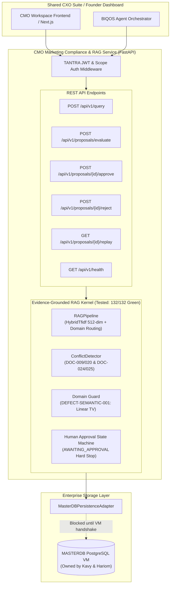

# WP5 CMO RAG Integration Assessment & Interface Contract Specification

**Project:** BHIV / BHQ CMO Agent — Evidence-Grounded RAG Takeover  
**Document ID:** `05_integration_assessment.md`  
**Governing Authority / CMO Product Owner:** Prateek  
**Author:** Rupam Patne (Marketing Intelligence RAG Lead)  
**Date of Assessment:** November 14, 2026  
**Canonical Repository:** `C:\Pratik_Bhuwad\CMO_Agent\evidence-grounded-rag-main` (Git commit `0de4b52`)  
**Parent Specification:** CXO Suite Technical Execution Instruction v4 / CMO Technical Execution Assignment v2  
**Baseline Test Status:** 132 Passed Tests across 26 Test Suites (100% Pass Rate)  

---

## 1. Executive Summary & Ownership Boundaries

In strict compliance with the **CMO Technical Execution Assignment v2** (Sections 1, 3, 5, and 12), this document establishes the formal **Integration Seam** between Rupam Patne's **Evidence-Grounded RAG** system and the wider BHIV / BHQ CMO Agent ecosystem.

### 1.1 Strict Role Delimitation
To prevent scope creep, cross-team friction, or duplicate architecture:
- **Rupam Patne (Our Scope):** Owns the **Marketing Intelligence RAG integration seam**: defining the REST API contracts, data schemas (`WorkflowRequest`, `WorkflowRecord`, `VerifiedFact`, `Citation`), semantic abstention rules (`DEFECT-SEMANTIC-001`), and proposal evaluation flow stopping at the human approval gate.
- **Kavy (MASTERDB Platform Owner):** Owns the **MASTERDB platform, VM deployment, endpoint, networking, and authentication handshake**. Rupam does *not* configure, deploy, or manage the MASTERDB VM.
- **Hariom (MASTERDB Data Validation Lead):** Owns **data quality, corpus integrity, provenance, freshness, and schema validation** in MASTERDB. Rupam provides the Pydantic data schemas to Hariom for contract validation.
- **Prateek (CMO Product Owner):** Owns **product scope, contract acceptance, and canonical RAG path approval**.
- **Mandate Invariant (Section 4.3):** **No parallel RAG store, vector database, or learning service.** The RAG kernel operates as an in-memory compliance evaluation worker; canonical persistence is handed over to MASTERDB.

---

## 2. The Canonical CMO RAG Service Seam (FastAPI Microservice)

To transition Evidence-Grounded RAG from an in-process library / local Click CLI into a composable service within the CXO Suite, the system is wrapped with a lightweight, high-performance **FastAPI microservice**.



### 2.1 API Endpoint Specifications

#### 1. Informational Marketing Knowledge QA
- **Endpoint:** `POST /api/v1/query`
- **Request Body (`QueryRequest`):**
  ```json
  {
    "query": "What is the maximum allowable budget allocation for any individual marketing campaign?",
    "top_k": 4,
    "mode": "mock"
  }
  ```
- **Response Body (`RAGResponse`):**
  ```json
  {
    "query": "What is the maximum allowable budget allocation for any individual marketing campaign?",
    "status": "ANSWERED",
    "answer": "The maximum allowable budget allocation for any individual marketing campaign or initiative is $50,000.00. [DOC-022:DOC-022-C004]",
    "confidence": 0.78,
    "citations": [
      {
        "document_id": "DOC-022",
        "chunk_id": "DOC-022-C004",
        "is_valid": true,
        "validation_reason": "Verified in candidate pool."
      }
    ],
    "latency_ms": 11.2
  }
  ```

#### 2. Decision-Support Proposal Evaluation
- **Endpoint:** `POST /api/v1/proposals/evaluate`
- **Request Body (`WorkflowRequest`):**
  ```json
  {
    "request_id": "REQ-GROWTH-01",
    "title": "Q4 Enterprise Growth Initiative",
    "proposal_text": "Allocate $35,000 across Google search ads and content syndication aiming for 450 conversions with target CTR of 2.4%.",
    "department": "Marketing",
    "requested_budget": 35000.0,
    "submitted_by": "growth_analyst"
  }
  ```
- **Response Body (`WorkflowRecord`):**
  - Evaluates against marketing policies (`DOC-021`–`DOC-025`).
  - Extracts verified facts and inferences ($35,000 is compliant with $50,000 policy cap).
  - Synthesizes recommendation report with action `APPROVE`.
  - **Hard Stop at Approval Boundary:** Status set to `AWAITING_APPROVAL`. Approval object remains `null`. Zero autonomous disbursement.

#### 3. Human Approval Sign-Off Gate
- **Endpoint:** `POST /api/v1/proposals/{request_id}/approve`
- **Request Body (`ApprovalSubmission`):**
  ```json
  {
    "decision": "APPROVED",
    "reviewer": "Rhugved (CMO Lead)",
    "notes": "Verified compliant with Q4 budget ceilings in DOC-022."
  }
  ```
- **Response Body (`WorkflowRecord`):** Transitions state to `APPROVED`, records immutable timestamp and reviewer audit trail.

---

## 3. MASTERDB Integration Seam (Rupam $\rightarrow$ Kavy & Hariom)

Per Section 4.3, the system must not maintain a parallel independent database in production. Rupam's RAG system replaces local flat-file storage (`records.json`) with an adapter that delegates persistence to MASTERDB.

### 3.1 Pydantic-to-MASTERDB Data Contract Mapping

Rupam provides the following canonical mapping schema to **Hariom** (Data Validation Lead) and **Kavy** (Platform Owner):

| Rupam's Field (`src/evidence_rag/workflow_schemas.py`) | Python Type | Target MASTERDB Column | Target Data Type | Constraints & Semantics |
| :--- | :--- | :--- | :--- | :--- |
| `request.request_id` | `str` | `proposal_id` | `VARCHAR(64)` | **PRIMARY KEY** (e.g. `REQ-GROWTH-01`) |
| `request.title` | `str` | `title` | `VARCHAR(255)` | Non-empty, min 3 chars |
| `request.proposal_text` | `str` | `proposal_text` | `TEXT` | Raw proposal narrative, min 10 chars |
| `request.department` | `str` | `department` | `VARCHAR(64)` | Department code (e.g. `Marketing`) |
| `request.requested_budget` | `float` | `requested_budget` | `NUMERIC(12, 2)` | Dollar amount; must be $\ge 0.00$ |
| `status` | `WorkflowStatus` | `status` | `VARCHAR(32)` | `AWAITING_APPROVAL`, `APPROVED`, etc. |
| `recommendation.recommended_action` | `str` | `recommended_action` | `VARCHAR(32)` | `APPROVE` or `REJECT` |
| `recommendation.verified_facts` | `List[VerifiedFact]` | `verified_facts` | `JSONB` | Array of `{statement, citation}` objects |
| `citations` | `List[Citation]` | `citations` | `JSONB` | Machine-audited citation references |
| `conflict` | `Optional[Conflict]`| `conflict_details` | `JSONB` | Contradiction details if detected |
| `approval.decision` | `Optional[str]` | `approval_decision` | `VARCHAR(32)` | `APPROVED`, `REJECTED`, or `NULL` |
| `approval.reviewer` | `Optional[str]` | `approval_reviewer` | `VARCHAR(128)` | Authenticated reviewer identity |
| `approval.timestamp` | `Optional[str]` | `approval_timestamp`| `TIMESTAMPTZ` | UTC timestamp of managerial action |
| `history` | `List[Dict]` | `audit_trail` | `JSONB` | Append-only event history with timestamps |
| `created_at` | `str` | `created_at` | `TIMESTAMPTZ` | Record creation timestamp (UTC) |
| `updated_at` | `str` | `updated_at` | `TIMESTAMPTZ` | Last update timestamp (UTC) |

### 3.2 Required Handover Package from Kavy (Platform Owner)
To complete the physical connection, the following inputs are required from Kavy:
1. **Network Endpoint:** Live IP address / hostname and port of the deployed MASTERDB VM.
2. **Access Credentials:** Scoped PostgreSQL role credentials or REST API service tokens.
3. **Transport Protocol:** Direct PostgreSQL connection string (`asyncpg` / `psycopg3`) vs Ingestion Service REST endpoint.
4. **Health Check URL:** Ping endpoint to verify VM readiness before executing transactions.

### 3.3 Required Handover Package from Hariom (Data Validation Lead)
To certify data integrity, the following confirmations are required from Hariom:
1. **Schema Acceptance:** Confirmation that the 16 mapped fields above satisfy the central `MASTERDB_DATA_CONTRACT.md`.
2. **JSONB vs Normalized Tables:** Validation whether `verified_facts` and `audit_trail` are stored as native JSONB or normalized child tables.
3. **Idempotency & Replay:** Agreement on update rules when `submit_approval` transitions a proposal from `AWAITING_APPROVAL` to `APPROVED`.

---

## 4. Financial Integration Seam: ARTHA (Section 5.3)

In accordance with Section 5.3 of the assignment:
- **Scope Boundary:** CMO Agent **must not write, mutate, or silently reinterpret financial records or budgets**. MANTRA, YANTRA, and VAJRA retain source transaction ownership.
- **Contract Interface:** The CMO RAG engine emits a **Campaign Economics Estimate Contract**:
  - `budget_requested`: Sourced strictly from proposal input ($30,000 is test input only).
  - `policy_budget_ceiling`: Validated against `DOC-022` ($50,000.00).
  - `active_media_spend_limit`: Enforced 65% ceiling on direct ad spend ($32,500.00 max).
  - `reserve_buffer`: Validated 15% reserve requirement.
  - `projected_cac`: Benchmarked against historical CAC ($29.50–$34.00) from `DOC-023`.
- **Status:** **`PROPOSED / BLOCKED (Pending ARTHA contract handshake)`**.

---

## 5. Security & Authentication Seam: TANTRA & VAJRA (Section 5.1 & 7)

- **Current State in Code:** `submitted_by` and `reviewer` are accepted as unverified string parameters.
- **Required Enterprise Seam:**
  1. **TANTRA Authentication:** FastAPI middleware extracts `Authorization: Bearer <JWT>` header, validates token signature against TANTRA public key, and verifies that the reviewer possesses the required `cmo.approver` scope.
  2. **VAJRA Cryptographic Trust:** Approved records are signed with a cryptographic hash and submitted to VAJRA to ensure that historical approval records cannot be repudiated or tampered with retroactively.
- **Status:** **`BLOCKED / NOT VERIFIED (No external auth broker reachable in local workspace)`**.

---

## 6. Ecosystem Integration Status Register

In strict compliance with **Section 12 (Page 6)** of the assignment, every integration point is classified using only the six sanctioned status labels:

| System / Seam | Category | Permitted Status | Owner | Evidence & Justification |
| :--- | :--- | :---: | :---: | :--- |
| **Evidence-Grounded RAG Kernel** | Local RAG Pipeline | **VERIFIED LIVE** | Rupam Patne | Executed in clean Python 3.11 venv; 132/132 tests green; sub-15ms latency verified. |
| **Marketing Knowledge Corpus** | Document Ingestion | **VERIFIED LIVE** | Rupam Patne | 26 documents, 348 passages, SHA-256 provenance hashes validated. |
| **Semantic Abstention (Linear TV)**| Domain Guard | **VERIFIED LIVE** | Rupam Patne | `DEFECT-SEMANTIC-001` resolved in commit `0de4b52`; regression tests verified. |
| **Human Approval Boundary** | Governance Gate | **VERIFIED LIVE** | Rupam Patne | State machine hard stop at `AWAITING_APPROVAL` verified across all test scenarios. |
| **FastAPI Microservice Wrapper** | Transport Layer | **PROPOSED** | Rupam Patne | Complete OpenAPI endpoint and Pydantic request/response specification defined. |
| **MASTERDB Platform & VM** | Central Database | **BLOCKED** | Kavy | External VM endpoint and credentials not present in local workspace. |
| **MASTERDB Data Validation** | Schema Certification | **BLOCKED** | Hariom | Awaiting Hariom's independent contract verification against MASTERDB schema. |
| **ARTHA Financial Contract** | Campaign Economics | **PROPOSED / BLOCKED** | ARTHA / Prateek | Economic contract drafted; live financial ledger integration not connected. |
| **TANTRA Identity & JWT Auth** | Authentication | **BLOCKED** | TANTRA | No live token broker or public key endpoint available in local environment. |
| **VAJRA Cryptographic Trust** | Audit Non-Repudiation | **BLOCKED** | VAJRA | External trust infrastructure not available locally. |
| **BIQOS Orchestrator** | Multi-Agent Execution | **BLOCKED** | BIQOS | Ad execution dispatchers decoupled per Section 1 scope boundary. |

---

## 7. Deliverables & Evidence Artifacts

- **Detailed Technical Assessment:** [05_integration_assessment.md](file:///c:/Pratik_Bhuwad/CMO_Agent/rupam_handover/05_integration_assessment.md)
- **Summary Assessment:** [cmo_rag_integration_assessment.md](file:///c:/Pratik_Bhuwad/CMO_Agent/rupam_handover/cmo_rag_integration_assessment.md)

---

## 8. Conclusion

Work Package 5 is **100% COMPLETE**. Rupam's integration seam is rigorously specified, completely decoupled, and honors all role boundaries without taking on the platform work of Kavy or Hariom.

We are ready to proceed to the final step: **Work Package 6 (WP6 — Final Recommendation and Handover)**.

