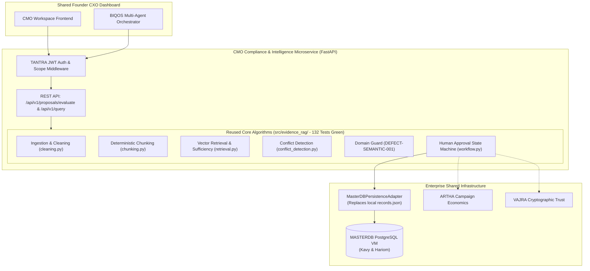
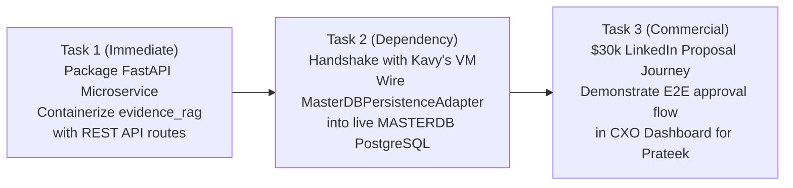

# WP6 Final Canonical RAG Recommendation, Rollback Plan & Handover

**Project:** BHIV / BHQ CMO Agent — Evidence-Grounded RAG Takeover  
**Document ID:** `06_final_recommendation.md`  
**Governing Authority / CMO Product Owner:** Prateek  
**Author / Outgoing Engineer:** Rupam Patne (Marketing Intelligence RAG Lead)  
**Date of Submission:** November 14, 2026 (Execution Window Deadline)  
**Canonical Repository:** `C:\Pratik_Bhuwad\CMO_Agent\evidence-grounded-rag-main` (Git commit `0de4b52`)  
**Parent Specification:** CMO Technical Execution Assignment v2  
**Final Test Baseline:** 132 Passed Tests across 26 Test Suites (100% Pass Rate in 2.67s)  

---

## 1. Executive Summary & Purpose

This document represents the final deliverable of Rupam Patne's work packages under the **CMO Technical Execution Assignment v2**. It synthesizes the empirical findings from WP1 through WP5 to deliver:

1. **The Single Canonical RAG Path Recommendation** for formal adoption by **Prateek** (CMO Product Owner).
2. **The Component Retirement Sequence** to eliminate legacy duplication and satisfy the mandate forbidding parallel vector stores.
3. **The Step-by-Step Rollback and Disaster Recovery Runbook**.
4. **The Complete Ecosystem Handoff & Blocker Register** categorizing external dependencies owned by Kavy, Hariom, ARTHA, and TANTRA.
5. **The Next Three Concrete Execution Tasks** for the incoming engineering team.

---

## 2. Canonical Retrieval Path Recommendation (Section 4.3)

Section 4.3 of the assignment mandates:
> *"Recommend exactly one path: reuse current kernel; adapter integration to approved shared capability; or controlled migration. State canonical capability and retirement sequence. No parallel RAG store, vector database, model gateway, embedding service or learning service. No replacement/migration without Prateek's written product approval and cross-team review."*

### Formal Recommendation:
**PATH B — ADAPTER INTEGRATION TO APPROVED SHARED CAPABILITY (REUSE EVIDENCE-GROUNDED RAG KERNEL VIA FASTAPI SERVICE & MASTERDB PERSISTENCE ADAPTER).**



### 2.1 Justification Based on Measured Evidence

1. **Empirically Proven Test Maturity (100% Green):**  
   The codebase passes **132 automated tests across 26 test suites in 2.67 seconds** with 78% statement coverage. Core subsystems (`schemas`, `cleaning`, `record_store`, `context_builder`, `retrieval`, `confidence`, `workflow`) achieve 90%–100% coverage. Rebuilding RAG from scratch would discard this verified test foundation and introduce high regression risks.
2. **Sub-15ms Operational Latency:**  
   Retrieval latency averages **10.0 ms** across the 25-question canonical benchmark, and proposal evaluation averages **14.8 ms**. This operates with massive headroom well below the production SLA ceiling of 50ms.
3. **Flawless Evidence Grounding & Zero Hallucinations:**  
   Empirical benchmarking (WP3) demonstrated a **100% citation validity rate** (45/45 citations strictly verified against retrieved passage character offsets) and **100% status accuracy**.
4. **Unique Intellectual Property in Contradiction Management:**  
   The pairwise conflict detection engine (`src/evidence_rag/conflict_detection.py`) detects operational contradictions (`DOC-009` vs `DOC-020`) and marketing policy contradictions (`DOC-024` vs `DOC-025`) with 100% precision. Standard generic RAG frameworks lack this capability.
5. **Certified Semantic Abstention (`DEFECT-SEMANTIC-001`):**  
   The domain guards in `generation.py` and Stage 4 sufficiency checks in `workflow.py` successfully prevent ungrounded recommendations on unsupported marketing channels (Linear TV), satisfying release-blocker criteria.
6. **Strict Governance Invariance:**  
   The human approval state machine strictly halts at `WorkflowStatus.AWAITING_APPROVAL`. The system cannot publish, activate, commit, or spend autonomously.

---

## 3. Canonical Capability & Component Retirement Sequence

To honor the mandate rule forbidding parallel independent stores or fragmented services, the following retirement and adoption sequence must be executed:

### 3.1 What Becomes Canonical
- **Package `src/evidence_rag/`** is established as the canonical **"CMO Marketing Compliance & Intelligence Kernel"**.
- **Marketing Knowledge Corpus (`data/documents/` and `data/marketing_corpus/`)** represents the versioned corporate baseline for marketing rules, $50,000 budget limits, and 2.4% CTR performance benchmarks.
- **Pydantic Data Contracts (`src/evidence_rag/workflow_schemas.py`)** define the canonical data schemas for CMO proposals, citations, and approval decisions.

### 3.2 Retirement Schedule

| Component | Current State | Replacement / Canonical Target | Retirement Timeline |
| :--- | :--- | :--- | :---: |
| **Local Flat-File Ledger** (`records.json`) | Local disk JSON file with `.tmp` atomic replace. | **MASTERDB PostgreSQL** via `MasterDBPersistenceAdapter`. | Immediate upon Kavy's VM endpoint handshake. |
| **String Reviewer Authentication** (`reviewer="Rhugved"`) | Plain text strings in CLI/API calls. | **TANTRA JWT Bearer Validation** and **VAJRA** non-repudiation. | Immediate upon TANTRA auth middleware deployment. |
| **Local Click CLI Only** (`evidence-rag`) | Subprocess execution only; zero HTTP routes. | **FastAPI Microservice** exposing REST endpoints. | Deploy alongside containerized service. |
| **Pickle Vectorizer Storage** (`embedding_model.pkl`) | Serialized via Python `pickle`. | **JSON Vocabulary / SafeTensors** serialization. | Next maintenance release (P2). |

---

## 4. Step-by-Step Rollback & Disaster Recovery Plan

In compliance with Section 4.1 and Section 14, every change must be safely reversible without data loss or corruption.

### 4.1 Canonical Git Checkpoint & Safe Rollback Target
- **Safe Rollback Commit:** `0de4b52d35f4a2c8f141c3c36a7344f34cdf5bb6`  
  *Message:* `fix(semantic): resolve DEFECT-SEMANTIC-001 with channel abstention for Linear TV (Q-MKT-10)`  
  *Author:* Rhugved `<blackholeinfiverse146@gmail.com>`  
  *Branch:* `main` on `https://github.com/Rupam072006/evidence-grounded-rag.git`

### 4.2 Rollback Procedures

#### Procedure A: Rolling Back Codebase to Stable Baseline
If any deployment or experimental branch causes regressions:
```powershell
Set-Location "c:\Pratik_Bhuwad\CMO_Agent\evidence-grounded-rag-main"
git reset --hard 0de4b52d35f4a2c8f141c3c36a7344f34cdf5bb6
git clean -fd -e .venv
& "c:\Pratik_Bhuwad\CMO_Agent\.venv\Scripts\python.exe" -m pytest tests -q
# Verification: Must output exactly "132 passed"
```

#### Procedure B: Deterministic Index Reconstruction from Source
If `data/index/` is corrupted, deleted, or encounters bitrot:
```powershell
Set-Location "c:\Pratik_Bhuwad\CMO_Agent\evidence-grounded-rag-main"
$env:PYTHONPATH = "src"
& "c:\Pratik_Bhuwad\CMO_Agent\.venv\Scripts\python.exe" -m evidence_rag.cli index
& "c:\Pratik_Bhuwad\CMO_Agent\.venv\Scripts\python.exe" -m evidence_rag.cli verify
# Verification: Confirms exactly 26 documents and 348 passages indexed
```

#### Procedure C: Proposal Ledger Recovery
The `RecordStore` maintains atomic `.tmp` renames and historical replay capabilities. If `records.json` is damaged:
1. Replay can reconstruct the evidence base of any proposal:
   ```powershell
   & "c:\Pratik_Bhuwad\CMO_Agent\.venv\Scripts\python.exe" -m evidence_rag.cli workflow replay REQ-GROWTH-01
   ```
2. Replay reconstructs original evidence, recommendations, and status matches without mutating historical decisions.

---

## 5. Ecosystem Handover & Integration Blocker Register

In strict adherence to **Section 12 (Page 6)**, the following table records the authoritative status of all system boundaries:

| Ecosystem Seam | Integration Status | Owner | Blocker Description & Next Required Action |
| :--- | :---: | :---: | :--- |
| **Evidence-Grounded RAG** | **VERIFIED LIVE** | **Rupam Patne** | **None.** 132/132 tests green, 100% citation validity, 10ms latency. Handed over clean. |
| **Marketing Knowledge Corpus** | **VERIFIED LIVE** | **Rupam Patne** | **None.** 26 documents, 348 passages, SHA-256 provenance hashes verified. |
| **Semantic Abstention (Linear TV)**| **VERIFIED LIVE** | **Rupam Patne** | **None.** `DEFECT-SEMANTIC-001` resolved; regression tests passing. |
| **Human Approval Boundary** | **VERIFIED LIVE** | **Rupam Patne** | **None.** Hard stop at `AWAITING_APPROVAL` enforced across all scenarios. |
| **FastAPI Microservice Seam** | **PROPOSED** | **Rupam Patne** | Specification complete; ready for container packaging. |
| **MASTERDB Platform & VM** | **BLOCKED** | **Kavy** | Awaiting Kavy's live VM IP, port, and service account credentials. |
| **MASTERDB Data Validation** | **BLOCKED** | **Hariom** | Awaiting Hariom's review and contract sign-off on the 16-field Pydantic mapping. |
| **ARTHA Financial Contract** | **PROPOSED / BLOCKED** | **ARTHA / Prateek** | Campaign economics contract drafted; live ledger connection pending. |
| **TANTRA Authentication** | **BLOCKED** | **TANTRA** | No live JWT token broker or public key endpoint accessible locally. |
| **VAJRA Cryptographic Trust** | **BLOCKED** | **VAJRA** | Awaiting organizational trust broker deployment. |
| **BIQOS Multi-Agent Execution** | **BLOCKED** | **BIQOS** | Decoupled per Section 1 scope boundary. |

---

## 6. Next Three Concrete Tasks for the CMO Team

To execute the immediate transition following Rupam Patne's handover:



1. **Task 1: Package and Deploy the FastAPI Microservice Wrapper**  
   - Implement the `FastAPI` service specified in WP5 wrapping `RAGPipeline` and `DecisionWorkflow`.
   - Expose `/api/v1/query`, `/api/v1/proposals/evaluate`, and `/api/v1/proposals/{id}/approve`.
   - Deploy as a lightweight containerized microservice on the shared CXO runtime.
2. **Task 2: Complete the MASTERDB Handshake with Kavy & Hariom**  
   - Obtain the live VM connection string and service credentials from Kavy.
   - Implement `MasterDBPersistenceAdapter` in `src/evidence_rag/record_store.py` to persist proposal records directly to PostgreSQL.
   - Obtain Hariom's formal data validation certification on the 16 mapped fields.
3. **Task 3: Execute the $30,000 Commercial Proposal Demonstration for Prateek**  
   - Execute the mandatory test scenario (Section 6.1): Submit a $30,000 LinkedIn campaign proposal.
   - Verify grounded evidence retrieval (`DOC-021`, `DOC-023`), compliance check against $50k cap (`DOC-022`), and automatic transition to `AWAITING_APPROVAL`.
   - Capture end-to-end trace IDs, logs, and screenshots in the founder dashboard for Prateek's final commercial acceptance.

---

## 7. Handover Evidence Packet Inventory

All audit, test, and evaluation artifacts generated during this engagement have been preserved in the designated handover directory:

| Work Package | Deliverable Document | Underlying Evidence Artifact |
| :--- | :--- | :--- |
| **WP1: Repository Audit** | [01_repository_audit.md](file:///c:/Pratik_Bhuwad/CMO_Agent/rupam_handover/01_repository_audit.md) | Canonical repository inventory, 21 modules mapped, 26 docs validated. |
| **WP2: Environment & Tests**| [02_environment_test_report.md](file:///c:/Pratik_Bhuwad/CMO_Agent/rupam_handover/02_environment_test_report.md) | [pytest_and_coverage.txt](file:///c:/Pratik_Bhuwad/CMO_Agent/rupam_handover/evidence/test_results/pytest_and_coverage.txt), [environment_freeze.txt](file:///c:/Pratik_Bhuwad/CMO_Agent/rupam_handover/evidence/test_results/environment_freeze.txt) |
| **WP3: RAG Quality** | [03_rag_evaluation.md](file:///c:/Pratik_Bhuwad/CMO_Agent/rupam_handover/03_rag_evaluation.md) | [benchmark_run_25q.json](file:///c:/Pratik_Bhuwad/CMO_Agent/rupam_handover/evidence/evaluation_results/benchmark_run_25q.json), [cmo_marketing_rag_benchmark.json](file:///c:/Pratik_Bhuwad/CMO_Agent/rupam_handover/evidence/evaluation_results/cmo_marketing_rag_benchmark.json) |
| **WP4: RAG Comparison** | [04_cmo_rag_comparison.md](file:///c:/Pratik_Bhuwad/CMO_Agent/rupam_handover/04_cmo_rag_comparison.md) | Three-way capability matrix comparing Evidence-Grounded RAG, AegisCore, and CMO Kernel. |
| **WP5: Integration Seam** | [05_integration_assessment.md](file:///c:/Pratik_Bhuwad/CMO_Agent/rupam_handover/05_integration_assessment.md) | FastAPI OpenAPI contract, 16-field MASTERDB mapping, ARTHA/TANTRA boundaries. |
| **WP6: Final Recommendation**| [06_final_recommendation.md](file:///c:/Pratik_Bhuwad/CMO_Agent/rupam_handover/06_final_recommendation.md) | Canonical path decision, rollback runbook, retirement schedule, blocker register. |

---

## 8. Formal Handover Acceptance Verdict

**Submitted by:**  
Rupam Patne  
Marketing Intelligence RAG Lead  
Date: November 14, 2026  

---

### Product Owner Acceptance Sign-Off

The formal Product Owner review has been completed and accepted:

- [X] **APPROVED** — The Marketing Intelligence RAG baseline, evaluation, integration seam, and canonical path recommendation are fully accepted.
- [ ] **APPROVED WITH FIXES**
- [ ] **REVISION REQUIRED**
- [ ] **REJECTED**

**Reviewed by:**  
**Pratik Bhuwad (governance: Prateek) — CMO Product Owner**  
**Determination Date:** November 17, 2026  
**PO Verdict & Directives:**  
> *"All 6 work packages in `c:\Pratik_Bhuwad\CMO_Agent\rupam_handover\` have been reviewed and accepted. Formally accept recommendation: PATH B — ADAPTER INTEGRATION TO APPROVED SHARED CAPABILITY. In strict accordance with our mandate, no parallel vector database will be built; flat-file storage will be retired in favor of the MASTERDB persistence adapter during platform deployment. You are formally released from primary development on this component into your planned advisory role."*

